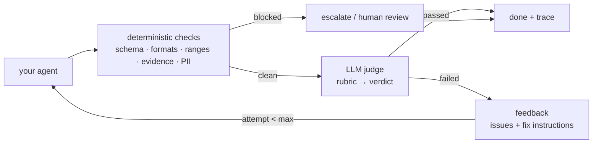

# agentqa

[](https://github.com/wizzhomie/agentqa/actions/workflows/ci.yml)

**Embedded QA for LLM agents.** A small, preset-driven library that puts quality control *inside*
the step that returns structured data: deterministic checks → LLM judge → bounded correction loop →
escalation, plus an offline regression suite that reuses the same preset.

> **Status: working core (phases 0–5).** Contracts, nine deterministic checks, the model layer, the
> rubric judge and the guarded runtime loop are in place: attempts, budget, escalation,
> `baseline` / `guarded` / `shadow`, trace. Offline evaluation, the example preset and live numbers
> land next (see [Roadmap](#roadmap)).

---

## Why

Any LLM step that must return structure (extract fields, parse an invoice, fill a ticket, build tool
arguments) fails in four ways:

| Failure | Looks like | Why it hurts |
|---|---|---|
| Format | not JSON, truncated, wrong type | fails loudly — the harmless case |
| **Fabrication** | a plausible value that is not in the input | never fails; it ships |
| Omission | the input had it, the output doesn't | surfaces days later |
| Logic | pickup after delivery, 300 t of cargo | priced on wrong numbers |

A schema validates the first row only. **The expensive failure is a schema-valid, beautifully
formatted invention.** Offline evals tell you what happened yesterday; they don't stop today's bad
answer.

`agentqa` covers both halves with one set of rules: the checks that gate a live run are the checks
that score a regression run.

## What it is / isn't

| It is | It isn't |
|---|---|
| A library (`pip install agentqa`), dropped into an existing pipeline | An agent framework — no graphs, no tool routing |
| A wrapper around **any** `case → structured output` function | A vendor lock-in to one SDK or provider |
| A preset-driven kit: core = mechanism, domain = your preset | A prompt library for one specific task |
| An offline harness: dataset, metrics, version diff, judge calibration | A SaaS eval platform with a dashboard |

Scope limit: **steps that return structure**. Free-form chat answers are out of scope — without a
contract there is nothing to check against.

## How it works



1. **Wrap.** `agent(case, feedback)` — your function, any internals.
2. **Check.** Cheap, deterministic, no tokens: schema, required fields, ISO formats, ranges,
   cross-field rules, quoted evidence, PII, truncation, refusals.
3. **Judge.** A model scores your rubric; **the code computes `passed`** from the weights, not the model.
4. **Correct.** Structured feedback with concrete instructions; at most 2 attempts, under a cost
   and latency budget.
5. **Decide.** `passed` / `passed_after_retry` / `escalated` (with reason) / `failed`, always with a
   trace of tokens, cost and time.

### Preset = "cartridge"

The core knows nothing about your domain. You bring:

```python
PRESET = Preset(
    name="logistics_intake",
    output_model=ExtractedIntake,          # Pydantic v2 contract
    checks=[required(...), formats(...), EvidenceCheck(paths=["origin", "cargo.weight"])],
    rubric=Rubric(criteria=[...]),         # weights + descriptions, data not prose
    agent_prompt=PROMPT,
    agent_model="deepseek-chat",
    scoring=ScoringSpec(fields=[...]),     # for offline comparison
)
```

Wrap the agent once, then run cases:

```python
guarded = guard(
    agent=extract_intake,                  # async (case, feedback | None) -> Attempt | AgentReply
    preset=PRESET,
    llm=OpenAICompatibleClient(model="deepseek-chat"),   # used by the judge only
    config=QAConfig(judge=JudgePolicy(model="deepseek-chat")),
)

result = await guarded.run(Case(case_id="mail-42", payload=email))

if result.blocking:                        # escalated or failed
    queue_for_human(result)                # reason + trace + the rejected answer included
else:
    use(result.output)

one_shot = await guarded.with_mode("baseline").run(Case(case_id="mail-42", payload=email))
```

The trace records every step with tokens, cost and latency; `result.totals` is the bill for that
case, judge included.

Three customization levels, none of which needs a fork: config (L1), your checks and rubric (L2),
your agent/judge/sinks (L3).

### Modes

| Mode | Behaviour | When |
|---|---|---|
| `baseline` | one call, no checks | the number to compare against |
| `guarded` | full loop | production |
| `shadow` | full loop, nothing blocked — trace only | first week on live traffic |

`shadow` is how you earn the right to block: a week of real traces beats an argument about
false positives.

## Offline regression

```text
baseline: pass 74%, fabrications 18%, $0.031/case, $0.042/passed, p95 4.1 s
guarded:  pass 94%, fabrications  2%, $0.077/case, $0.082/passed, p95 11.6 s, escalations 6%
```

Metrics: pass rate before/after retry, retry recovery, escalation rate, hallucination rate,
field accuracy, p50/p95 latency, tokens, cost per case and per *passed* case — plus judge
calibration (agreement, Cohen's κ, false passes) against hand-labelled cases.

## Relationship to existing tools

They mostly answer *"how good is the model"*: Guardrails validates output, DeepEval and promptfoo
run offline evaluations, LangSmith/Langfuse trace. `agentqa` answers *"what do we do with this
particular bad answer, and what did that cost"* — and reuses one preset for both the live loop and
the regression run.

## Roadmap

| Phase | Content | State |
|---|---|---|
| 0 | design docs | ✅ |
| 1 | skeleton, contracts, config, CI | ✅ |
| 2 | built-in checks + tests | ✅ |
| 3 | LLM layer: fake, replay, OpenAI-compatible, Anthropic | ✅ |
| 4 | judge, rubric scoring, calibration | ✅ |
| 5 | runtime loop: attempts, budget, modes, escalation, trace | ✅ |
| 6 | offline evals: dataset, metrics, report, diff | — |
| 7 | toy preset + `examples/logistics_intake` + docs | — |
| 8 | live run, cassettes, numbers in README | — |

## Docs

- [`docs/design.md`](docs/design.md) — contracts, checks catalogue, runtime loop, evals, roadmap
- [`docs/how-it-works.md`](docs/how-it-works.md) — plain-language explanation and the decision log
  (every choice with alternatives, cost, and when to revisit it)

## License

MIT — see [LICENSE](LICENSE).
