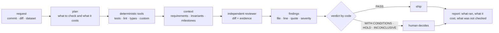

# qagent

[](https://github.com/wizzhomie/qagent/actions/workflows/ci.yml)

**Independent verification for AI-assisted development.** You hand it a change — a commit, a diff,
a dataset run — and it returns findings and a verdict backed by evidence it collected itself, not
by what the coding agent said about its own work.

*[Читать по-русски →](README.ru.md)*

> **Where the project is right now.** The evaluation core works and is measured: deterministic
> checks, a rubric judge, a bounded correction loop, offline regression with report diff, two
> examples with committed live runs and cassettes. The verification loop is being built phase by
> phase; the plan and the decisions are in [`docs/roadmap.md`](docs/roadmap.md). What works
> already: the project profile (`qagent inspect`), the deterministic engine (`qagent run`), the
> end-to-end pass — checks → findings → verdict → report (`qagent verify`) — and the independent
> reviewer, which proposes findings about a diff and has each one checked against the file.

---

## Why

An AI agent finishes a task and reports: done, tests pass, requirements met, no regressions.
None of that is evidence. The failure modes are boring and expensive:

| Claim | What actually happens | Cost |
|---|---|---|
| "Tests pass" | they pass on a subset, or were weakened to pass | a regression ships |
| "Done" | the happy path is done, the edge cases are not | found by a user |
| "Requirements met" | something plausible was built, not the requested thing | rework |
| "No regressions" | nobody ran the paths that regressed | incident |
| "Architecture respected" | the layer was imported directly, tomorrow it is load-bearing | slow rot |

The principle this project is built around:

> **AI-generated claims are not verification evidence.**

Tool output, reproducible checks and findings that can be re-derived are evidence. Text is not. A
verification system has to get its own access to the data, run the available tools itself, and
conclude from what it saw — including saying "I could not check this".

## What it is / isn't

| It is | It isn't |
|---|---|
| An independent verification loop around a project: context → plan → evidence → findings → verdict | A coding agent, an IDE, or a CI platform |
| A library and a CLI (`pip install -e .` for now, not on PyPI) | A service, a dashboard, or a multi-tenant platform |
| A universal core: the same mechanics for any repository | A collection of hardcoded rules about specific projects |
| Measured against planted defects, with its own evaluation loop | A prompt library, or a wrapper around one vendor SDK |

Deliberately out of scope: writing or changing the verified project, autonomous self-improvement,
reimplementing static analyzers that already exist, and any "run everything by default" mode —
verification is selective and budgeted by design ([why](docs/roadmap.md)).

## How it works (target)



1. **Context.** What this project is, how it is built, what it promises, what must not break.
2. **Plan.** Cheap deterministic checks first, money spent only where they leave a question.
3. **Evidence.** Every check produces a structured result with captured output; a check that did
   not run is `error` or `not applicable`, never `ok`.
4. **Review.** A model reads the diff and the evidence and proposes findings — but each finding
   must be anchored: the file exists, the line is in range, the quote is verbatim on that line.
   A finding that fails the anchor is reported as unverified, not silently dropped.
5. **Verdict.** The code computes it from gates, evidence and policy — never from a score the
   model produced: `PASS`, `PASS WITH CONDITIONS`, `HOLD`, `INCONCLUSIVE`.
6. **Report.** Scope, checks, findings, evidence, limitations, what was skipped and why, what it
   cost.

## Two levels: core and project

The core knows how to verify; it knows nothing about your project. Knowledge about the project
lives in the project itself, in `.qagent/`: profile, architecture baseline and target, milestones,
requirements, invariants, verification policies. It is committed with the code and reviewed like
the code, because it goes stale at the same speed. QAgent stays a tool, not a store of other
people's projects.

Verification modes (`pre-commit`, `change review`, `feature evaluation`, `architecture review`,
`security audit`, `regression`, `dataset evaluation`, `full audit`) are **data**: each is a policy
file naming mandatory gates, depth and cost ceiling. The code path is one.

## Selective and budgeted

There is no mode that runs everything. A run starts from a request and a budget, and the plan
orders work from cheap to expensive: project commands (tests, lint, types) cost seconds and no
tokens; the reviewer costs money, so it gets the changed files and the evidence, after the
deterministic tools have spoken, and only if there is still a question. When the budget runs out
before the questions do, the verdict says `INCONCLUSIVE` — never a quiet `PASS`. The report lists
what was not checked and why; a second run on the same inputs is cached.

## What runs today

The table below is the honest part: what is built, what it does, and how to see it work. The
evaluation core provides the evidence and the ability to measure the loop itself; the verification
engine turns that evidence into a verdict.

| Piece | What it does | Proof |
|---|---|---|
| Deterministic checks | required fields, formats, ranges, cross-field rules, quoted evidence, PII, refusals, duplicates | 9 built-in checks, extendable by config or code |
| Independent judge | a model scores a data-driven rubric; **the code** recomputes pass/score from weights | judge cannot grade itself |
| Bounded loop | structured feedback, at most N attempts, cost and latency budget, escalation with a reason | every step recorded in the trace |
| Preset as a file | schema, checks, rubric, prompts, limits, prices, report — one `qagent.toml` | config and code build the same preset, fingerprint-tested |
| Offline regression | dataset → run → scoring → metrics → report → diff of two runs | comparable only with matching hashes |
| Reproducibility | committed cassettes replay a live run with no key and no bill | `make replay` |
| Project profile | reads a repository from disk — languages, package managers, test/lint/type commands, entry points — with no model and no network | `qagent inspect`, deterministic and digest-stable |
| Command execution | runs the project's own checks — argv only, whitelisted environment, timeout, budget — and keeps stdout/stderr as artifacts | `qagent run`; a missing tool is `not_applicable`, not a pass |
| Independent reviewer | a model reads the diff and proposes findings; the anchor confirms only a file in the change, a line that exists, and a verbatim quote | `qagent verify --diff ... --reviewer ...`; an unverified finding never blocks |
| Project knowledge | requirements, invariants, milestones and the architecture baseline/target in `.qagent/context.toml`, each with `approved` / `proposed` / `superseded` | `qagent context --check`; only approved items bind |
| Findings and verdict | failures become structured findings; four verdicts computed by code from the checks, with the reason for each | `qagent verify`; `HOLD` is exit 1, `INCONCLUSIVE` is exit 2 |
| Verification report | verdict, reasons, every check with its evidence, findings, and the list of what was **not** checked | `report.md`, rendered from `report.json` |

```bash
qagent inspect --repo . --write            # describe the repository: stack, checks, layout
qagent context --repo . --check            # what the project promises, and the links to checks
qagent run --repo . --policy .qagent/policy.toml   # run its checks, keep the evidence
qagent verify --repo .                     # run, decide a verdict, write the report pair
qagent verify --repo . --diff change.diff --reviewer qagent.review.factory:from_env  # + review
qagent init --dir ./qa                     # starter config plus a one-case dataset
qagent check --config qagent.toml          # validate config and dataset, run nothing
qagent eval  --config qagent.toml --out reports/guarded.json --markdown reports/guarded.md
qagent record --config qagent.toml         # live model, answers written to the cassette
qagent replay --config qagent.toml         # same numbers from the cassette, free
qagent compare a.json b.json               # what changed between two runs
```

`qagent run` and `qagent verify` execute the commands exactly as the policy writes them. The
policy in this repo expects the checkout's `.venv/bin` on `PATH`, the same assumption the Makefile
makes with `PYTHON=.venv/bin/python`.

`qagent verify` is the first end-to-end pass of the loop: it runs the policy, turns failures into
findings, computes the verdict in code, and writes `report.json` + `report.md` into the run
directory. The exit code is `0` for `PASS` / `PASS WITH CONDITIONS`, `1` for `HOLD`, `2` for
`INCONCLUSIVE` — a pipeline can stop on it without parsing prose. On this repository, `make verify`
gives `PASS` with three checks in about two seconds and no model call.

### Example 0 — a claim the verdict does not believe (HOLD)

A tiny invoice module with a planted defect: it ignores `Item.quantity`, so the happy path looks
right and one of the project's own tests fails. `make verify-demo` runs the policy, gets exit 1 from
the test suite, and produces [`reports/verification_demo/report.md`](reports/verification_demo/report.md)
— verdict `HOLD`, one reason, one blocking finding, and the failing assertion kept as an artifact.
No model was asked whether the tests pass: the exit code is the evidence. The demo project is
[`examples/verification_demo/`](examples/verification_demo/README.md).

### Example 0b — the reviewer on its own commit

On 2026-11-23 the reviewer read the diff of the commit that introduced it: four proposals, all
four quotes confirmed by the anchor, and three of the four were real problems in code written
minutes earlier — a byte ceiling counted in characters, a path comparison without normalisation,
and an anchor that read the working tree without asking whether the diff had shown that line. The
report is [`reports/review_self/report.md`](reports/review_self/report.md), and
[its README](reports/review_self/README.md) says what happened to each finding. A real model call,
8 827 input tokens, 4.1 s.

### Example 1 — logistics intake (32 cases)

An email → structured fields step, guarded: 59.4% correct on the first attempt, **81.2% after the
loop**, false passes 40.6% → 18.8%, $0.108 for the run. The report, the diff against the baseline
run and the cassette are committed in [`reports/`](reports/README.md) and
[`examples/logistics_intake/`](examples/logistics_intake/README.md).

### Example 2 — code review on seeded bugs (24 cases)

A reviewer that must point at the planted bug by line and verbatim quote. Cheap anchor checks
reject an invented quote, a line outside the file and a verdict that contradicts the findings, for
free, before any judge is asked. Live run: **87.5% final, 0 false passes** (12.5% before), $0.0477
for 24 cases, p50 2.9 s. This example is also the template for how the verification loop will
validate findings: [`examples/code_review/`](examples/code_review/README.md).

## How the two halves fit

The evaluation core does not sit beside the verification loop — it gets absorbed into it. Concrete
plan, in order:

1. A dataset run becomes a **check type** inside the verification engine: the policy names a
   dataset and a config, the engine runs it as a tool with a timeout and attaches its report as
   evidence.
2. The rubric judge becomes one of the **reviewers** — it can read a change, not only a single
   answer.
3. The loop's checks and retries become how the behaviour of a step is **measured**, which is what
   makes the verification loop itself measurable.

Nothing already built is deleted or renamed for elegance; the old modules change only when their
new role is actually used.

## Roadmap

| Phase | What | Status |
|---|---|---|
| 0 | Architecture assessment: what exists, what the gap is, decisions | done — [`docs/roadmap.md`](docs/roadmap.md) |
| 1 | Project context: profile, requirements, invariants, baseline | done — `qagent inspect` and `qagent context` |
| 2 | Verification orchestrator: request, plan, run, persistence | planned |
| 3 | Deterministic engine: run project tools, capture evidence, statuses | done — `qagent run` |
| 4 | Independent reviewer: change analysis, architecture, tests, risk | done — `qagent verify --diff` with a reviewer |
| 5 | Findings, verdict, verification report | done — `qagent verify` |
| 6 | Architecture contracts and traceability | planned |
| 7 | Verification evolution: proposed rules, validation, promotion | planned |
| 8 | Risk-based plans, sandbox, mutation testing, holdout evaluation | planned |

## Docs

- [`docs/roadmap.md`](docs/roadmap.md) — vision, principles, phases, decisions, non-goals.
- [`docs/design.md`](docs/design.md) — why the core is built the way it is, with the alternatives.
- [`docs/how-it-works.md`](docs/how-it-works.md) — the same, in plain language, step by step.
- [`reports/README.md`](reports/README.md) — the committed runs and how to read them.

## License

MIT.
