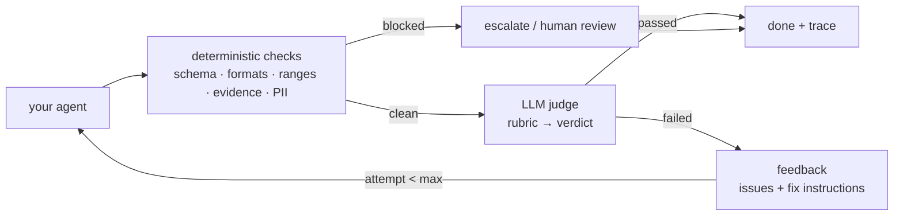

# qagent

[](https://github.com/wizzhomie/qagent/actions/workflows/ci.yml)

**Embedded QA for LLM agents.** A small, preset-driven library that puts quality control *inside*
the step that returns structured data: deterministic checks → LLM judge → bounded correction loop →
escalation, plus an offline regression suite that reuses the same preset.

*[Читать по-русски →](README.ru.md)*

> **Status: phases 0–8 — the core, a complete example, and a real run.** Contracts, nine
> deterministic checks, the model layer, the rubric judge, the guarded loop, offline regression
> with report diff, and `examples/logistics_intake`: 32 labelled cases, a committed DeepSeek run
> (pass 59% → 81%, false passes 41% → 19%) and the cassette that replays it without a key or a
> bill. The cheap mode (`make demo`, no model calls) still runs in seconds.

---

## Why

Any LLM step that must return structure (extract fields, parse an invoice, fill a ticket, build tool
arguments) fails in four ways:

| Failure | Looks like | Why it hurts |
|---|---|---|
| Format | not JSON, truncated, wrong type | fails loudly — the harmless case |
| **Fabrication** | a plausible value that is not in the input | never fails; it ships |
| Omission | the input had it, the output doesn't | surfaces days later |
| Logic | pickup after delivery, 300 t of cargo | priced on wrong numbers |

A schema validates the first row only. **The expensive failure is a schema-valid, beautifully
formatted invention.** Offline evals tell you what happened yesterday; they don't stop today's bad
answer.

`qagent` covers both halves with one set of rules: the checks that gate a live run are the checks
that score a regression run.

## What it is / isn't

| It is | It isn't |
|---|---|
| A library (`pip install -e .` for now, not on PyPI), dropped into an existing pipeline | An agent framework — no graphs, no tool routing |
| A wrapper around **any** `case → structured output` function | A vendor lock-in to one SDK or provider |
| A preset-driven kit: core = mechanism, domain = your preset | A prompt library for one specific task |
| An offline harness: dataset, metrics, version diff, judge calibration | A SaaS eval platform with a dashboard |

Scope limit: **steps that return structure**. Free-form chat answers are out of scope — without a
contract there is nothing to check against.

## How it works



1. **Wrap.** `agent(case, feedback)` — your function, any internals.
2. **Check.** Cheap, deterministic, no tokens: schema, required fields, ISO formats, ranges,
   cross-field rules, quoted evidence, PII, truncation, refusals.
3. **Judge.** A model scores your rubric; **the code computes `passed`** from the weights, not the model.
4. **Correct.** Structured feedback with concrete instructions; at most 2 attempts, under a cost
   and latency budget.
5. **Decide.** `passed` / `passed_after_retry` / `escalated` (with reason) / `failed`, always with a
   trace of tokens, cost and time.

### Preset = "cartridge"

The core knows nothing about your domain. You bring:

```python
PRESET = Preset(
    name="logistics_intake",
    output_model=ExtractedIntake,          # Pydantic v2 contract
    checks=[required(...), formats(...), EvidenceCheck(paths=["origin", "cargo.weight"])],
    rubric=Rubric(criteria=[...]),         # weights + descriptions, data not prose
    agent_prompt=PROMPT,
    agent_model="deepseek-flash",
    scoring=ScoringSpec(fields=[...]),     # for offline comparison
)
```

A complete version of this — schema, eight checks, rubric, prompt, 32 labelled cases and a
scoring spec — is [`examples/logistics_intake`](examples/logistics_intake/README.md).

Wrap the agent once, then run cases:

```python
guarded = guard(
    agent=extract_intake,                  # async (case, feedback | None) -> Attempt | AgentReply
    preset=PRESET,
    llm=OpenAICompatibleClient(model="deepseek-flash"),   # used by the judge only
    config=QAConfig(judge=JudgePolicy(model="deepseek-v4-pro")),
)

result = await guarded.run(Case(case_id="mail-42", payload=email))

if result.blocking:                        # escalated or failed
    queue_for_human(result)                # reason + trace + the rejected answer included
else:
    use(result.output)

one_shot = await guarded.with_mode("baseline").run(Case(case_id="mail-42", payload=email))
```

The trace records every step with tokens, cost and latency; `result.totals` is the bill for that
case, judge included.

Three customization levels, none of which needs a fork: config (L1), your checks and rubric (L2),
your agent/judge/sinks (L3).

### The same cartridge as a file

The preset above can be a `qagent.toml` instead, so a new project starts from a settings file
rather than from a copy of this library's wiring:

```bash
qagent init --dir ./qa             # starter config plus a one-case dataset
qagent check --config qagent.toml  # validate the file and the dataset, run nothing
qagent eval --config qagent.toml --out reports/guarded.json --markdown reports/guarded.md
```

[`examples/logistics_intake/qagent.toml`](examples/logistics_intake/qagent.toml) describes the same
preset as `preset.py`: both build a preset with the same fingerprint, and a replay run through the
file reproduces the committed numbers. Two things stay code, because a file cannot choose a
provider or read a key — `agent = "module:factory"` and `judge_client = "module:factory"`. A check
with a Python predicate is named under `[checks] extra`; a domain retry hint under
`retry_builder`.

### Modes

| Mode | Behaviour | When |
|---|---|---|
| `baseline` | one call, no checks | the number to compare against |
| `guarded` | full loop | production |
| `shadow` | full loop, nothing blocked — trace only | first week on live traffic |

`shadow` is how you earn the right to block: a week of real traces beats an argument about
false positives.

## A complete preset: logistics intake

[`examples/logistics_intake`](examples/logistics_intake/README.md) turns dirty freight emails into
`ExtractedIntake` — origin, destination, cargo, dates, amount, contact — without inventing a value.
It is the reference for what a cartridge looks like: a schema, eight checks (five of them domain
rules), a rubric, a prompt, 32 labelled cases with fabrication traps, and reports checked into the
repository.

| | |
|---|---|
| Live run, DeepSeek `deepseek-flash` | [guarded report](reports/guarded.md) · [baseline vs guarded](reports/diff.md) |
| Stub run, no model calls | [guarded report](reports/sample_guarded.md) · [baseline vs guarded](reports/sample_diff.md) |
| The preset, file by file | [`examples/logistics_intake/README.md`](examples/logistics_intake/README.md) |
| Run it | `make demo` (free) · `make replay` (free, committed cassette) · `make eval` (live) |

The live run (32 cases, 2026-11-22, no reasoning budget — see U37 below) moves the numbers the way
the design intends: correct answers 59.4% → 81.2%, false passes 40.6% → 18.8%, and the six answers
that still slip through are visible in the diff by name. The gate never escalated a case: nine were
retried, six of them recovered. Latency is the price — 1.4 s → 3.0 s per case — and cost goes from
$0.0008 to $0.0034 per case, which is still cents for the whole suite.

The stub run replays golden answers with one scripted defect each, so it measures the loop, not a
model: 75% → 94% correct, false passes 25% → 3%, two escalations. Use it to see the mechanics
without a key; use the live reports for what a model actually does.

## Offline regression

The same preset scores a dataset. Pass rates are **ground truth** against the golden values, not
"the gate let it through" — so a wrong answer approved by the loop is its own metric:

```
$ python -m qagent eval --spec examples.logistics_intake.runner:build_guarded \
      --dataset examples/logistics_intake/dataset.jsonl \
      --out reports/guarded.json --markdown reports/guarded.md
20261122T165644-guarded-394398a: 32 cases, pass 81.2% -> reports/guarded.json

$ python -m qagent compare reports/baseline.json reports/guarded.json \
      --markdown reports/diff.md
```

The report carries `run_id`, commit, `preset_hash`, `dataset_hash`, both families of numbers (quality
vs. loop behaviour) and per-case rows; `compare` raises a flag when the dataset changed, because then
the numbers are not comparable. Metrics: pass rate before/after retry, false pass rate, retry
recovery, escalation rate, hallucination rate, field accuracy, p50/p95 latency, tokens, cost per case
and per *passed* case — plus judge calibration (agreement, Cohen's κ, false passes) against
hand-labelled cases.

> `QAGENT_LLM` selects the source: `live` (needs `DEEPSEEK_API_KEY`), `replay` (the committed
> cassette — same numbers, no key, no network) or `stub` (the demo preset above). The committed
> live reports were produced with reasoning switched off at the provider (`reasoning_effort: none`),
> because hidden thinking cost ten times the run; the report states the model, not the mood of the
> model, so treat these as numbers for that mode.

## Relationship to existing tools

They mostly answer *"how good is the model"*: Guardrails validates output, DeepEval and promptfoo
run offline evaluations, LangSmith/Langfuse trace. `qagent` answers *"what do we do with this
particular bad answer, and what did that cost"* — and reuses one preset for both the live loop and
the regression run.

## Roadmap

| Phase | Content | State |
|---|---|---|
| 0 | design docs | ✅ |
| 1 | skeleton, contracts, config, CI | ✅ |
| 2 | built-in checks + tests | ✅ |
| 3 | LLM layer: fake, replay, OpenAI-compatible, Anthropic | ✅ |
| 4 | judge, rubric scoring, calibration | ✅ |
| 5 | runtime loop: attempts, budget, modes, escalation, trace | ✅ |
| 6 | offline evals: dataset, metrics, report, diff | ✅ |
| 7 | example preset, dataset, sample reports, Russian README | ✅ |
| 8 | live run, cassettes, numbers in README | ✅ |

## Docs

- [`examples/logistics_intake/README.md`](examples/logistics_intake/README.md) — the preset end to
  end: files, checks, dataset decisions, how to build your own
- [`docs/design.md`](docs/design.md) — contracts, checks catalogue, runtime loop, evals, roadmap
- [`docs/how-it-works.md`](docs/how-it-works.md) — plain-language explanation and the decision log
  (every choice with alternatives, cost, and when to revisit it)
- [`reports/README.md`](reports/README.md) — what the committed sample reports are, and what they
  are not

## License

MIT — see [LICENSE](LICENSE).
