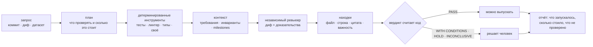

# qagent

[](https://github.com/wizzhomie/qagent/actions/workflows/ci.yml)

**Независимая проверка результатов AI-разработки.** Ему отдают изменение — коммит, диф, прогон
датасета — и получают находки и вердикт, основанные на доказательствах, которые он собрал сам, а
не на словах кодирующего агента о собственной работе.

*[Read in English →](README.md)*

> **Где проект находится сейчас.** Ядро оценки работает и измерено: детерминированные проверки,
> судья по рубрике, ограниченный цикл исправления, оффлайн-регрессия со сравнением отчётов,
> два примера с закоммиченными живыми прогонами и кассетами, 388 тестов. Контур верификации —
> понимание проекта, план с бюджетом, запуск инструментов в чужом репозитории, находки и
> вердикты — сейчас строится, фаза за фазой; план и решения в
> [`docs/roadmap.md`](docs/roadmap.md). **Команды `verify` ещё нет**: ниже отдельно написано,
> что работает сегодня, и отдельно — что впереди.

---

## Почему

AI-агент заканчивает задачу и докладывает: готово, тесты проходят, требования выполнены,
регрессий нет. Ни одно из этих слов не является доказательством. Ошибки скучные и дорогие:

| Утверждение | Что происходит на самом деле | Цена |
|---|---|---|
| «Тесты проходят» | проходят на подмножестве, или их ослабили, чтобы прошли | регрессия уходит в прод |
| «Готово» | сделан счастливый путь, краевые случаи — нет | находит пользователь |
| «Требования выполнены» | сделано похожее, но не то, что просили | переделка |
| «Регрессий нет» | никто не запускал сломавшиеся пути | инцидент |
| «Архитектура соблюдена» | слой импортировали напрямую, завтра это уже несущая конструкция | медленная деградация |

Принцип, на котором построен проект:

> **Утверждения AI — не доказательство проверки.**

Доказательство — это вывод инструмента, воспроизводимая проверка и находка, которую можно
перепроверить. Текст — нет. Система проверки должна сама получать доступ к данным, сама запускать
доступные инструменты и делать вывод по увиденному — включая честное «это я проверить не смог».

## Что это и чем не является

| Это | Это не |
|---|---|
| Независимый контур проверки вокруг проекта: контекст → план → доказательства → находки → вердикт | Кодирующий агент, IDE или CI-платформа |
| Библиотека и CLI (`pip install -e .` пока, не на PyPI) | Сервис, дашборд или многопользовательская платформа |
| Универсальное ядро: одна механика для любого репозитория | Набор захардкоженных правил про конкретные проекты |
| Измеряется на подложенных дефектах собственным eval-контуром | Библиотека промптов или обёртка над одним вендорским SDK |

Осознанно вне рамок: писать и менять проверяемый проект, бесконтрольно самоулучшаться,
переписывать существующие анализаторы и иметь режим «прогнать всё по умолчанию» — проверка
выборочная и с бюджетом ([почему](docs/roadmap.md)).

## Как это работает (целевое состояние)



1. **Контекст.** Что это за проект, как он собирается, что обещает, что нельзя ломать.
2. **План.** Сначала дешёвые детерминированные проверки; деньги тратятся только там, где они
   оставили вопрос.
3. **Доказательства.** Каждая проверка даёт структурированный результат с сохранённым выводом;
   проверка, которая не запустилась, — это `error` или `not applicable`, никогда не `ok`.
4. **Ревью.** Модель читает диф и доказательства и предлагает находки — но каждая находка должна
   быть привязана: файл существует, строка в диапазоне, цитата дословно на этой строке. Находка,
   не прошедшая привязку, попадает в «неподтверждённые», а не исчезает молча.
5. **Вердикт.** Считает код из гейтов, доказательств и политики — никогда из оценки, которую
   поставила модель: `PASS`, `PASS WITH CONDITIONS`, `HOLD`, `INCONCLUSIVE`.
6. **Отчёт.** Объём проверки, проверки, находки, доказательства, ограничения, что пропущено и
   почему, сколько стоило.

## Два уровня: ядро и проект

Ядро умеет проверять; про конкретный проект оно не знает ничего. Знания о проекте живут в самом
проекте, в каталоге `.qagent/`: профиль, архитектурный baseline и target, milestones, требования,
инварианты, политики проверки. Они коммитятся вместе с кодом и ревьюятся как код, потому что
стареют с той же скоростью. QAgent остаётся инструментом, а не хранилищем чужих проектов.

Режимы проверки (`pre-commit`, `change review`, `feature evaluation`, `architecture review`,
`security audit`, `regression`, `dataset evaluation`, `full audit`) — это **данные**: каждый режим
это файл политики, где названы обязательные гейты, глубина и потолок цены. Код — один.

## Выборочно и с бюджетом

Режима «прогнать всё» нет. Прогон начинается с запроса и бюджета, а план выстраивает работу от
дешёвого к дорогому: команды проекта (тесты, линтер, типы) стоят секунды и ни одного токена;
ревьюер стоит денег, поэтому получает изменённые файлы и доказательства после того, как
детерминированные инструменты уже сказали своё, и только если вопрос остался. Если бюджет
кончился раньше вопросов, вердикт — `INCONCLUSIVE`, а не тихий `PASS`. В отчёте написано, что не
проверялось и почему; повторный прогон на тех же входах берётся из кэша.

## Что работает сегодня

Таблица ниже — честная часть: это ядро оценки, и именно из него контур верификации берёт
доказательства и умение измерять себя.

| Часть | Что делает | Чем доказано |
|---|---|---|
| Детерминированные проверки | обязательные поля, форматы, диапазоны, межполевые правила, цитаты, ПДн, отказы, дубликаты | 9 встроенных проверок, расширяются конфигом или кодом |
| Независимый судья | модель оценивает рубрику, **код** пересчитывает pass и score из весов | судья не может поставить себе оценку |
| Ограниченный цикл | структурированный фидбек, не больше N попыток, бюджет по деньгам и времени, эскалация с причиной | каждый шаг записан в трейс |
| Пресет как файл | схема, проверки, рубрика, промпты, лимиты, цены, отчёт — один `qagent.toml` | конфиг и код собирают одинаковый пресет, это проверяет тест |
| Оффлайн-регрессия | датасет → прогон → скоринг → метрики → отчёт → сравнение двух прогонов | сравнимы только при совпадении хешей |
| Воспроизводимость | закоммиченные кассеты повторяют живой прогон без ключа и счёта | `make replay` |

```bash
qagent init --dir ./qa                     # стартовый конфиг и датасет из одного кейса
qagent check --config qagent.toml          # проверить конфиг и датасет, ничего не запуская
qagent eval  --config qagent.toml --out reports/guarded.json --markdown reports/guarded.md
qagent record --config qagent.toml         # живая модель, ответы пишутся в кассету
qagent replay --config qagent.toml         # те же цифры из кассеты, бесплатно
qagent compare a.json b.json               # что изменилось между двумя прогонами
```

### Пример 1 — приём заявок на логистику (32 кейса)

Шаг «письмо → структурированные поля»: 59.4% верных с первой попытки, **81.2% после цикла**,
ложные пропуски 40.6% → 18.8%, $0.108 за прогон. Отчёт, сравнение с baseline и кассета
закоммичены в [`reports/`](reports/README.md) и
[`examples/logistics_intake/`](examples/logistics_intake/README.md).

### Пример 2 — код-ревью на подложенных багах (24 кейса)

Ревьюер обязан указать на баг строкой и дословной цитатой. Дешёвые проверки-якоря отбрасывают
выдуманную цитату, строку вне файла и вердикт, противоречащий находкам, — бесплатно, до любого
судьи. Живой прогон: **87.5% в итоге, 0 ложных пропусков** (было 12.5%), $0.0477 за 24 кейса,
p50 2.9 с. Этот пример — ещё и шаблон того, как контур будет проверять находки:
[`examples/code_review/`](examples/code_review/README.md).

## Как две половины соединяются

Ядро оценки не стоит рядом с контуром верификации — оно в него входит. План по шагам:

1. Прогон по датасету становится **видом проверки** внутри движка верификации: политика называет
   датасет и конфиг, движок запускает его как инструмент с таймаутом и прикладывает отчёт как
   доказательство.
2. Судья по рубрике становится одним из **ревьюеров** — он сможет читать изменение, а не только
   один ответ.
3. Проверки и повторы цикла становятся способом **измерять поведение шага**, а значит и сам контур
   верификации становится измеримым.

Ничего из уже сделанного не удаляется и не переименовывается ради красоты; старые модули меняются
только когда их новая роль уже используется.

## Дорожная карта

| Фаза | Что | Статус |
|---|---|---|
| 0 | Архитектурная оценка: что есть, в чём разрыв, какие решения приняты | сделано — [`docs/roadmap.md`](docs/roadmap.md) |
| 1 | Контекст проекта: профиль, требования, инварианты, baseline | в работе |
| 2 | Оркестратор проверки: запрос, план, прогон, сохранение | запланировано |
| 3 | Детерминированный движок: запуск инструментов проекта и сбор доказательств | запланировано |
| 4 | Независимый ревьюер: изменения, архитектура, тесты, риски | запланировано |
| 5 | Находки, вердикт, отчёт о проверке | запланировано |
| 6 | Архитектурные контракты и трассировка | запланировано |
| 7 | Эволюция проверок: предложения, проверка на истории, одобрение | запланировано |
| 8 | Планы по риску, песочница, mutation testing, holdout | запланировано |

## Документация

- [`docs/roadmap.md`](docs/roadmap.md) — видение, принципы, фазы, решения, чего не делаем.
- [`docs/design.md`](docs/design.md) — почему ядро устроено именно так, с альтернативами.
- [`docs/how-it-works.md`](docs/how-it-works.md) — то же простыми словами, по шагам.
- [`reports/README.md`](reports/README.md) — закоммиченные прогоны и как их читать.

## Лицензия

MIT.
