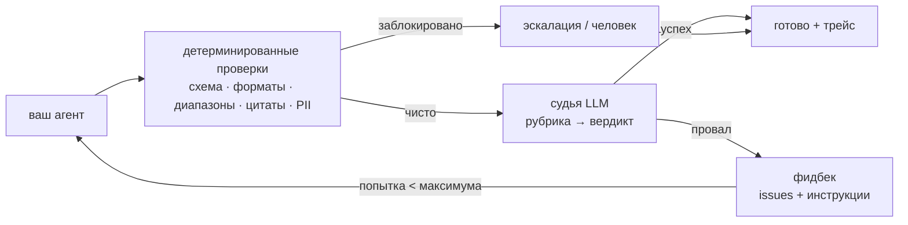

# agentqa

[](https://github.com/wizzhomie/agentqa/actions/workflows/ci.yml)

**Встроенное QA для LLM-агентов.** Небольшая библиотека, управляемая пресетами: она ставит контроль
качества *внутрь* шага, который возвращает структурированные данные — детерминированные проверки →
судья на LLM → ограниченный цикл самокоррекции → эскалация, плюс офлайн-регрессия на том же пресете.

*[Read in English →](README.md)*

> **Статус: фазы 0–7 — ядро и законченный пример.** Контракты, девять детерминированных проверок,
> слой моделей, судья по рубрике, защищённый цикл, офлайн-регрессия со сравнением отчётов и
> `examples/logistics_intake`: реальный пресет, 32 размеченных кейса и закоммиченные образцы отчётов,
> которые запускаются через `make demo` без API-ключа. Живые цифры моделей — фаза 8
> (см. [Дорожную карту](#дорожная-карта)).

---

## Зачем

Любой шаг LLM, обязанный вернуть структуру (извлечь поля, разобрать счёт, заполнить заявку, собрать
аргументы инструмента), проваливается четырьмя способами:

| Провал | Как выглядит | Чем плохо |
|---|---|---|
| Формат | не JSON, обрезано, не тот тип | падает громко — безобидный случай |
| **Фабрикация** | правдоподобное значение, которого нет во входе | не падает никогда; уезжает в прод |
| Пропуск | во входе было, в выходе нет | всплывает через дни |
| Логика | погрузка после выгрузки, 300 т груза | считают по неверным числам |

Схема проверяет только первую строку. **Дорогой провал — это прошедшая схему, красиво
отформатированная выдумка.** Офлайн-оценка скажет, что случилось вчера; сегодняшний плохой ответ она
не остановит.

`agentqa` закрывает обе половины одним набором правил: проверки, которые стоят на пути живого
прогона, — это те же проверки, которые оценивают регрессионный прогон.

## Что это / что это не

| Это | Это не |
|---|---|
| Библиотека (`pip install agentqa`), вставляется в существующий пайплайн | Агентский фреймворк — без графов и маршрутизации инструментов |
| Обёртка над **любой** функцией `вход → структурированный выход` | Привязка к одному SDK или провайдеру |
| Конструктор на пресетах: ядро — механизм, домен — ваш пресет | Библиотека промптов под одну задачу |
| Офлайн-стенд: датасет, метрики, сравнение версий, калибровка судьи | SaaS-платформа оценки с дашбордом |

Граница применимости: **шаги, возвращающие структуру**. Свободный чат вне области — без контракта
проверять нечего.

## Как это работает



1. **Обернуть.** `agent(case, feedback)` — ваша функция, любые внутренности.
2. **Проверить.** Дёшево, детерминированно, без токенов: схема, обязательные поля, ISO-форматы,
   диапазоны, межполевые правила, цитаты-доказательства, PII, обрезка, отказы.
3. **Оценить.** Модель заполняет рубрику; **`passed` считает код** по весам, а не модель.
4. **Исправить.** Структурированный фидбек с конкретными инструкциями; не больше двух попыток, под
   бюджетом по деньгам и времени.
5. **Решить.** `passed` / `passed_after_retry` / `escalated` (с причиной) / `failed` — всегда с
   трейсом токенов, стоимости и времени.

### Пресет = «картридж»

Ядро не знает ничего о вашем домене. Домен приносите вы:

```python
PRESET = Preset(
    name="logistics_intake",
    output_model=ExtractedIntake,          # контракт Pydantic v2
    checks=[required(...), formats(...), EvidenceCheck(paths=["origin", "cargo.weight"])],
    rubric=Rubric(criteria=[...]),         # веса + описания: данные, а не проза
    agent_prompt=PROMPT,
    agent_model="deepseek-flash",
    scoring=ScoringSpec(fields=[...]),     # для офлайн-сравнения
)
```

Полная версия — схема, восемь проверок, рубрика, промпт, 32 размеченных кейса и спецификация
скоринга — лежит в [`examples/logistics_intake`](examples/logistics_intake/README.md).

Оберните агент один раз и запускайте кейсы:

```python
guarded = guard(
    agent=extract_intake,                  # async (case, feedback | None) -> Attempt | AgentReply
    preset=PRESET,
    llm=OpenAICompatibleClient(model="deepseek-flash"),   # нужен только судье
    config=QAConfig(judge=JudgePolicy(model="deepseek-v4-pro")),
)

result = await guarded.run(Case(case_id="mail-42", payload=email))

if result.blocking:                        # escalated или failed
    queue_for_human(result)                # причина + трейс + отвергнутый ответ внутри
else:
    use(result.output)

one_shot = await guarded.with_mode("baseline").run(Case(case_id="mail-42", payload=email))
```

Трейс записывает каждый шаг с токенами, стоимостью и задержкой; `result.totals` — счёт за этот кейс
вместе с судьёй.

Три уровня кастомизации, ни один не требует форка: конфиг (L1), свои проверки и рубрика (L2), свой
агент/судья/приёмники (L3).

### Режимы

| Режим | Поведение | Когда |
|---|---|---|
| `baseline` | один вызов, без проверок | число, с которым сравниваем |
| `guarded` | полный цикл | прод |
| `shadow` | полный цикл, ничего не блокируется — только трейс | первая неделя на живом трафике |

`shadow` — способ заработать право блокировать: неделя реальных трейсов убедительнее спора о ложных
срабатываниях.

## Законченный пресет: логистический интейк

[`examples/logistics_intake`](examples/logistics_intake/README.md) превращает грязные письма
перевозчиков в `ExtractedIntake` — откуда, куда, груз, даты, сумма, контакт — не выдумывая ни одного
значения. Это эталон «картриджа»: схема, восемь проверок (пять из них — доменные правила), рубрика,
промпт, 32 размеченных кейса с ловушками для фабрикаций и закоммиченные отчёты.

| | |
|---|---|
| Stub-прогон, без вызовов модели | [отчёт guarded](reports/sample_guarded.md) · [baseline против guarded](reports/sample_diff.md) |
| Пресет по файлам | [`examples/logistics_intake/README.md`](examples/logistics_intake/README.md) |
| Запуск | `make demo` (бесплатно) · `make sample` (пересобрать отчёты) · `make eval` (живая модель) |

Stub-прогон повторяет золотые ответы с одним запрограммированным дефектом на кейс, поэтому измеряет
цикл, а не модель: 75% → 94% правильных, ложные пропуски 25% → 3%, две эскалации и один выдуманный
вес, которого не видит ни одна детерминированная проверка — ровно для этого и существует метрика
ложных пропусков. Живые цифры модели заменят его в фазе 8.

## Офлайн-регрессия

Тот же пресет оценивает датасет. Pass rate считается по **золотым значениям**, а не по тому, «пропустил
ли гейт» — поэтому неверный ответ, который цикл принял, получает отдельную метрику:

```
$ python -m agentqa eval --spec examples.logistics_intake.runner:build_guarded \
      --dataset examples/logistics_intake/dataset.jsonl \
      --out reports/guarded.json --markdown reports/guarded.md
20261122T151956-guarded-521ed3d: 32 cases, pass 93.8% -> reports/guarded.json

$ python -m agentqa compare reports/baseline.json reports/guarded.json \
      --markdown reports/diff.md
```

В отчёте есть `run_id`, коммит, `preset_hash`, `dataset_hash`, оба семейства чисел (качество и
поведение цикла) и построчная таблица кейсов; `compare` поднимает флаг, если датасет изменился —
тогда числа несравнимы. Метрики: pass rate до/после ретрая, доля ложных пропусков, восстановление
после ретрая, доля эскалаций, доля галлюцинаций, точность полей, p50/p95 задержки, токены, стоимость
на кейс и на *правильный* кейс — плюс калибровка судьи (согласие, κ Коэна, ложные пропуски) по
размеченным вручную кейсам.

> Это прогон демо-пресета, и `AGENTQA_LLM=stub` — режим по умолчанию: 93.8% — работа цикла на золотых
> ответах, а не модель. Живые числа дают `AGENTQA_LLM=live` (с `DEEPSEEK_API_KEY`) или
> `AGENTQA_LLM=replay` (закоммиченная кассета); фаза 8 их запишет.

## Отношение к существующим инструментам

Они в основном отвечают на вопрос «насколько хороша модель»: Guardrails валидирует выход, DeepEval и
promptfoo запускают офлайн-оценки, LangSmith/Langfuse трассируют. `agentqa` отвечает на вопрос «что
делать с этим конкретным плохим ответом и сколько это стоило» — и переиспользует один пресет и для
живого цикла, и для регрессионного прогона.

## Дорожная карта

| Фаза | Содержание | Состояние |
|---|---|---|
| 0 | проектные документы | ✅ |
| 1 | скелет, контракты, конфиг, CI | ✅ |
| 2 | встроенные проверки + тесты | ✅ |
| 3 | слой моделей: fake, кассеты, OpenAI-совместимый, Anthropic | ✅ |
| 4 | судья, рубрика, калибровка | ✅ |
| 5 | цикл: попытки, бюджет, режимы, эскалация, трейс | ✅ |
| 6 | офлайн: датасет, метрики, отчёт, сравнение | ✅ |
| 7 | пример-пресет, датасет, образцы отчётов, русский README | ✅ |
| 8 | живой прогон, кассеты, цифры в README | — |

## Документы

- [`examples/logistics_intake/README.md`](examples/logistics_intake/README.md) — пресет целиком: файлы,
  проверки, решения по датасету, как собрать свой
- [`docs/design.md`](docs/design.md) — контракты, каталог проверок, цикл, офлайн-оценка, фазы
- [`docs/how-it-works.md`](docs/how-it-works.md) — то же простым языком и журнал решений
  (каждый выбор с альтернативами, ценой и условиями пересмотра)
- [`reports/README.md`](reports/README.md) — что такое закоммиченные образцы отчётов и чем они не
  являются

## Лицензия

MIT — см. [LICENSE](LICENSE).
