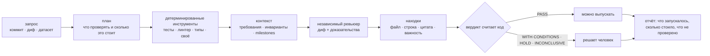

# qagent

[](https://github.com/wizzhomie/qagent/actions/workflows/ci.yml)

**Независимая проверка результатов AI-разработки.** Ему отдают изменение — коммит, диф, прогон
датасета — и получают находки и вердикт, основанные на доказательствах, которые он собрал сам, а
не на словах кодирующего агента о собственной работе.

*[Read in English →](README.md)*

> **Где проект находится сейчас.** Ядро оценки работает и измерено: детерминированные проверки,
> судья по рубрике, ограниченный цикл исправления, оффлайн-регрессия со сравнением отчётов,
> два примера с закоммиченными живыми прогонами и кассетами. Контур верификации строится фаза за
> фазой; план и решения в [`docs/roadmap.md`](docs/roadmap.md). Что уже работает: профиль проекта
> (`qagent inspect`), детерминированный движок (`qagent run`), полный проход —
> проверки → находки → вердикт → отчёт (`qagent verify`) — независимый ревьюер, который
> предлагает находки по дифу, а каждая проверяется по файлу, — и эволюция правил (`qagent learn`):
> контур предлагает изменить свои же проверки, доказывает предложение прошлыми прогонами и ждёт
> ручного одобрения.

---

## Почему

AI-агент заканчивает задачу и докладывает: готово, тесты проходят, требования выполнены,
регрессий нет. Ни одно из этих слов не является доказательством. Ошибки скучные и дорогие:

| Утверждение | Что происходит на самом деле | Цена |
|---|---|---|
| «Тесты проходят» | проходят на подмножестве, или их ослабили, чтобы прошли | регрессия уходит в прод |
| «Готово» | сделан счастливый путь, краевые случаи — нет | находит пользователь |
| «Требования выполнены» | сделано похожее, но не то, что просили | переделка |
| «Регрессий нет» | никто не запускал сломавшиеся пути | инцидент |
| «Архитектура соблюдена» | слой импортировали напрямую, завтра это уже несущая конструкция | медленная деградация |

Принцип, на котором построен проект:

> **Утверждения AI — не доказательство проверки.**

Доказательство — это вывод инструмента, воспроизводимая проверка и находка, которую можно
перепроверить. Текст — нет. Система проверки должна сама получать доступ к данным, сама запускать
доступные инструменты и делать вывод по увиденному — включая честное «это я проверить не смог».

## Что это и чем не является

| Это | Это не |
|---|---|
| Независимый контур проверки вокруг проекта: контекст → план → доказательства → находки → вердикт | Кодирующий агент, IDE или CI-платформа |
| Библиотека и CLI (`pip install -e .` пока, не на PyPI) | Сервис, дашборд или многопользовательская платформа |
| Универсальное ядро: одна механика для любого репозитория | Набор захардкоженных правил про конкретные проекты |
| Измеряется на подложенных дефектах собственным eval-контуром | Библиотека промптов или обёртка над одним вендорским SDK |

Осознанно вне рамок: писать и менять проверяемый проект, бесконтрольно самоулучшаться,
переписывать существующие анализаторы и иметь режим «прогнать всё по умолчанию» — проверка
выборочная и с бюджетом ([почему](docs/roadmap.md)).

## Как это работает (целевое состояние)



1. **Контекст.** Что это за проект, как он собирается, что обещает, что нельзя ломать.
2. **План.** Сначала дешёвые детерминированные проверки; деньги тратятся только там, где они
   оставили вопрос.
3. **Доказательства.** Каждая проверка даёт структурированный результат с сохранённым выводом;
   проверка, которая не запустилась, — это `error` или `not applicable`, никогда не `ok`. Проверки
   идут под потолками ресурсов из политики, и отчёт называет их потолками, а не изоляцией.
4. **Ревью.** Модель читает диф и доказательства и предлагает находки — но каждая находка должна
   быть привязана: файл существует, строка в диапазоне, цитата дословно на этой строке. Находка,
   не прошедшая привязку, попадает в «неподтверждённые», а не исчезает молча.
5. **Вердикт.** Считает код из гейтов, доказательств и политики — никогда из оценки, которую
   поставила модель: `PASS`, `PASS WITH CONDITIONS`, `HOLD`, `INCONCLUSIVE`.
6. **Отчёт.** Объём проверки, проверки, находки, доказательства, ограничения, что пропущено и
   почему, сколько стоило.

## Два уровня: ядро и проект

Ядро умеет проверять; про конкретный проект оно не знает ничего. Знания о проекте живут в самом
проекте, в каталоге `.qagent/`: профиль, архитектурный baseline и target, milestones, требования,
инварианты, политики проверки. Они коммитятся вместе с кодом и ревьюятся как код, потому что
стареют с той же скоростью. QAgent остаётся инструментом, а не хранилищем чужих проектов.

Режимы проверки (`pre-commit`, `change review`, `feature evaluation`, `architecture review`,
`security audit`, `regression`, `dataset evaluation`, `full audit`) — это **данные**: каждый режим
это файл политики, где названы обязательные гейты, глубина и потолок цены. Код — один.

## Выборочно и с бюджетом

Режима «прогнать всё» нет. Прогон начинается с запроса и бюджета, а план выстраивает работу от
дешёвого к дорогому: команды проекта (тесты, линтер, типы) стоят секунды и ни одного токена;
ревьюер стоит денег, поэтому получает изменённые файлы и доказательства после того, как
детерминированные инструменты уже сказали своё, и только если вопрос остался. Если бюджет
кончился раньше вопросов, вердикт — `INCONCLUSIVE`, а не тихий `PASS`. В отчёте написано, что не
проверялось и почему; повторный прогон на тех же входах берётся из кэша.

Проверка может ещё и сказать, что она сторожит: `when_paths` делает её гейтом для части
репозитория, поэтому изменение в `app.py` не платит за проверку миграций. План строится от
изменения, каждая невыбранная проверка попадает в отчёт с причиной, а прогон **без** изменения
планирует всё: неизвестное изменение может затронуть что угодно, и дешёвый план, выбросивший
гейт, — не дешёвый.

## Что работает сегодня

Таблица ниже — честная часть: что построено, что оно делает и как это увидеть. Ядро оценки
даёт доказательства и умение измерять сам контур; движок верификации превращает эти
доказательства в вердикт.

| Часть | Что делает | Чем доказано |
|---|---|---|
| Детерминированные проверки | обязательные поля, форматы, диапазоны, межполевые правила, цитаты, ПДн, отказы, дубликаты | 9 встроенных проверок, расширяются конфигом или кодом |
| Независимый судья | модель оценивает рубрику, **код** пересчитывает pass и score из весов | судья не может поставить себе оценку |
| Ограниченный цикл | структурированный фидбек, не больше N попыток, бюджет по деньгам и времени, эскалация с причиной | каждый шаг записан в трейс |
| Пресет как файл | схема, проверки, рубрика, промпты, лимиты, цены, отчёт — один `qagent.toml` | конфиг и код собирают одинаковый пресет, это проверяет тест |
| Оффлайн-регрессия | датасет → прогон → скоринг → метрики → отчёт → сравнение двух прогонов | сравнимы только при совпадении хешей |
| Воспроизводимость | закоммиченные кассеты повторяют живой прогон без ключа и счёта | `make replay` |
| Профиль проекта | читает репозиторий с диска — языки, менеджеры пакетов, команды тестов/линтера/типов, точки входа — без модели и без сети | `qagent inspect`, детерминирован и стабилен по хешу |
| Запуск проверок | запускает собственные проверки проекта — только argv, окружение из белого списка, таймаут, бюджет — и сохраняет stdout/stderr как артефакты | `qagent run`; отсутствующий инструмент — `not_applicable`, а не «прошло» |
| Лимиты ресурсов | каждая проверка идёт под потолком памяти и размера файла из `[sandbox]`, и отчёт тут же говорит, что **не** изолировано: сеть и файловая система | `make verify` на этом репозитории; проверка, упёршаяся в потолок, названа именно так, а платформа без лимитов отказывается запускать проверку без них |
| Независимый ревьюер | модель читает диф и предлагает находки; якорь подтверждает только файл из изменения, существующую строку и дословную цитату | `qagent verify --diff ... --reviewer ...`; неподтверждённая находка никогда не блокирует |
| Кэш ревью | уже оплаченный отзыв переиспользуется только когда вопрос совпадает дословно — промпт, модель, температура, потолок токенов — и отчёт говорит, что ответ взят из кэша | повторный прогон по тому же изменению не зовёт модель; `--no-cache` зовёт |
| Знания о проекте | требования, инварианты, milestones и baseline/target архитектуры в `.qagent/context.toml`, у каждого статус `approved` / `proposed` / `superseded` | `qagent context --check`; обязательства — только approved |
| Оркестратор | один запрос (политика, изменение, ревьюер, бюджет) превращается в один сохранённый прогон, который можно перечитать и объяснить | `qagent verify --request request.toml`, `qagent show <прогон>` |
| Трассировка | каждое утверждённое требование или инвариант связан со своими проверками, находками, которые на него ссылаются, и одним из четырёх состояний: covered, failed, not-run, unchecked | раздел `## Traceability` в каждом отчёте; ревьюер может ссылаться только на утверждённые id; в живом прогоне демо находка `F1` ссылается на `R1`, и строка `failed` стоит по обеим причинам |
| План под изменение | проверка может объявить, какие пути она сторожит; прогон планирует её только если изменение их касается, а отчёт говорит, почему она не запускалась | `make plan-demo`: SQL-проверка не выбрана для изменения в `app.py` |
| Находки и вердикт | провалы превращаются в структурные находки; четыре вердикта считает код по результатам проверок, с причиной для каждого | `qagent verify`; `HOLD` — код выхода 1, `INCONCLUSIVE` — 2 |
| Отчёт о проверке | вердикт, причины, каждая проверка со своим доказательством, находки и список того, что **не** проверялось | `report.md`, рендер `report.json` |
| Эволюция правил | читает решённые прогоны, предлагает превратить необязательную проверку в обязательную и пересчитывает прошлые вердикты тем же `decide()`; принятое правило — файл в проекте, политика не переписывается | `make evolve-demo`: три прогона, предложение, `HOLD` после одобрения |
| Holdout-бенч | фиксированный набор изменений, у которых вердикт записан до прогона: подложенный дефект обязан удержаться, чистое изменение — нет, и промах считается отдельно от ложной тревоги; пять кейсов — дефекты, которые видит только ревьюер, четыре — изменения без дефекта | `make bench`: 3 из 3 дефектов слоя проверок удержаны, 0 из 4 чистых изменений, без модели; живой `--layer all`: 3 из 3 удержаны, 5 из 5 кейсов ревьюера найдены, 1 из 4 чистых изменений удержано (ложная тревога названа отдельно) |

```bash
qagent inspect --repo . --write            # описать репозиторий: стек, инструменты, структура
qagent context --repo . --check            # что проект обещает и на какие проверки это опирается
qagent run --repo . --policy .qagent/policy.toml   # запустить его проверки и сохранить доказательства
qagent verify --repo .                     # запустить, вынести вердикт, написать пару отчётов
qagent verify --repo . --diff change.diff --reviewer qagent.review.factory:from_env  # + ревью
qagent verify --repo . --request request.toml      # то же самое, описанное файлом
qagent show .qagent/runs/<run id>                  # объяснить сохранённый прогон, ничего не запуская
qagent learn --repo .                      # что история прогонов предлагает изменить и почему
qagent learn --repo . --approve <id> --note "почему"  # записать решение по предложению
qagent init --dir ./qa                     # стартовый конфиг и датасет из одного кейса
qagent check --config qagent.toml          # проверить конфиг и датасет, ничего не запуская
qagent eval  --config qagent.toml --out reports/guarded.json --markdown reports/guarded.md
qagent record --config qagent.toml         # живая модель, ответы пишутся в кассету
qagent replay --config qagent.toml         # те же цифры из кассеты, бесплатно
qagent compare a.json b.json               # что изменилось между двумя прогонами
```

`qagent run` и `qagent verify` запускают команды ровно так, как они записаны в политике.
Политика в этом репозитории рассчитывает на `.venv/bin` в `PATH` — то же допущение, что и в
Makefile (`PYTHON=.venv/bin/python`).

`qagent verify` — первый полный проход цикла: запускает политику, превращает провалы в находки,
считает вердикт кодом и пишет `report.json` + `report.md` в каталог прогона. Код выхода: `0` —
`PASS` / `PASS WITH CONDITIONS`, `1` — `HOLD`, `2` — `INCONCLUSIVE`; пайплайн может остановиться
по нему, не разбирая текст. На этом репозитории `make verify` даёт `PASS` с тремя проверками за
несколько секунд, под лимитами из собственной политики, и без единого вызова модели.

`qagent learn` — вторая половина: контур не только проверяет, но и предлагает, **что** проверять.
Он читает решённые прогоны, ищет необязательную проверку, которая падала в прогонах, всё равно
ушедших с `PASS`/`PASS WITH CONDITIONS`, и пересчитывает те же прогоны с этой проверкой в
обязательных — тем же кодом вердикта, на тех же записанных доказательствах. Ничего не запускается
и ничего не стоит. Предложение — данные: что изменится, какие прогоны его доказывают и сколько
вердиктов оно бы остановило. Принять его может только человек: `--approve` пишет файл в проект,
а `policy.toml` остаётся таким, каким его написали. Подробности — в
[`docs/roadmap.md`](docs/roadmap.md) и в демо [`examples/evolve_demo/`](examples/evolve_demo/README.md).

### Пример 0 — утверждение, которому вердикт не верит (HOLD)

Маленький модуль счетов с подложенным дефектом: он игнорирует `Item.quantity`, поэтому
счастливый путь выглядит правильно, а один из собственных тестов проекта падает. `make verify-demo`
запускает политику, получает от тестов код 1 и пишет
[`reports/verification_demo/report.md`](reports/verification_demo/report.md) — вердикт `HOLD`,
одна причина, одна блокирующая находка и упавший assert, сохранённый артефактом. Модель не
спрашивали, проходят ли тесты: доказательство — код возврата. Проект заявляет и собственное
требование, поэтому в том же отчёте есть строка трассировки: `R1` в состоянии `failed` — с
проверкой, которая упала, и (в живом прогоне того же демо) с находкой, которая на него
ссылается. Сам демо-проект — [`examples/verification_demo/`](examples/verification_demo/README.md).

### Пример 0б — ревьюер на собственном коммите

23 ноября 2026 ревьюер прочитал диф коммита, которым сам появился: четыре предложения, все
четыре цитаты подтверждены якорем, и три из четырёх оказались настоящими проблемами в коде,
написанном за минуты до этого — потолок в символах вместо байт, сравнение путей без нормализации
и якорь, который читал рабочее дерево, не проверив, показывал ли диф эту строку. Отчёт —
[`reports/review_self/report.md`](reports/review_self/report.md), а
[его README](reports/review_self/README.md) говорит, что стало с каждой находкой. Живой вызов
модели: 8 827 входных токенов, 4.1 с.

### Пример 0в — правило, заработанное историей

В [`examples/evolve_demo/`](examples/evolve_demo/README.md) лежит проект с настоящим дефектом:
аннотация обещает `int`, функция возвращает `float`, тесты зелёные, а типы ловят — но проверка
типов в политике необязательная. Три настоящих прогона в `history/` показывают одно и то же:
`PASS WITH CONDITIONS`, проверка типов падала, изменение всё равно ушло. `make evolve-demo`
предлагает сделать проверку обязательной и говорит, какие три вердикта это остановило бы.
После `--approve` следующий прогон с тем же дефектом получает `HOLD` — то же доказательство,
другое правило, и в шапке отчёта написано, какое правило действовало.

### Пример 1 — приём заявок на логистику (32 кейса)

Шаг «письмо → структурированные поля»: 59.4% верных с первой попытки, **81.2% после цикла**,
ложные пропуски 40.6% → 18.8%, $0.108 за прогон. Отчёт, сравнение с baseline и кассета
закоммичены в [`reports/`](reports/README.md) и
[`examples/logistics_intake/`](examples/logistics_intake/README.md).

### Пример 2 — код-ревью на подложенных багах (24 кейса)

Ревьюер обязан указать на баг строкой и дословной цитатой. Дешёвые проверки-якоря отбрасывают
выдуманную цитату, строку вне файла и вердикт, противоречащий находкам, — бесплатно, до любого
судьи. Живой прогон: **87.5% в итоге, 0 ложных пропусков** (было 12.5%), $0.0477 за 24 кейса,
p50 2.9 с. Этот пример — ещё и шаблон, по которому контур уже проверяет находки:
[`examples/code_review/`](examples/code_review/README.md).

### Запрос — это файл

Прогон — это один запрос: какая политика, какое изменение, какой ревьюер, сколько токенов.
Это можно назвать флагами или записать файлом:

```toml
name = "ревью фикса в кассе"
policy = ".qagent/policy.toml"
since = "HEAD~1"                                  # или: diff = "change.patch"
reviewer = "qagent.review.factory:from_env"
instructions = ".qagent/review.md"
max_tokens = 1500
```

`qagent verify --repo . --request request.toml` сохраняет запрос внутри отчёта, поэтому
`qagent show` через месяцы ответит «что просили, что случилось, что это значит» — не запуская
ни проверки, ни модели. В этом и смысл оркестратора: вердикт, который нельзя восстановить, —
это фраза, а не запись.

## Как две половины соединяются

Ядро оценки не стоит рядом с контуром верификации — оно в него входит. План по шагам:

1. Прогон по датасету становится **видом проверки** внутри движка верификации: политика называет
   датасет и конфиг, движок запускает его как инструмент с таймаутом и прикладывает отчёт как
   доказательство.
2. Судья по рубрике становится одним из **ревьюеров** — он сможет читать изменение, а не только
   один ответ.
3. Проверки и повторы цикла становятся способом **измерять поведение шага**, а значит и сам контур
   верификации становится измеримым.

Ничего из уже сделанного не удаляется и не переименовывается ради красоты; старые модули меняются
только когда их новая роль уже используется.

## Дорожная карта

| Фаза | Что | Статус |
|---|---|---|
| 0 | Архитектурная оценка: что есть, в чём разрыв, какие решения приняты | сделано — [`docs/roadmap.md`](docs/roadmap.md) |
| 1 | Контекст проекта: профиль, требования, инварианты, baseline | сделано — `qagent inspect` и `qagent context` |
| 2 | Оркестратор проверки: запрос, план, прогон, сохранение | сделано — `--request` и `qagent show` |
| 3 | Детерминированный движок: запуск инструментов проекта и сбор доказательств | сделано — `qagent run` |
| 4 | Независимый ревьюер: изменения, архитектура, тесты, риски | сделано — `qagent verify --diff` с ревьюером |
| 5 | Находки, вердикт, отчёт о проверке | сделано — `qagent verify` |
| 6 | Архитектурные контракты и трассировка | сделано — требование → проверка → находка → вердикт в отчёте |
| 7 | Эволюция проверок: предложения, проверка на истории, одобрение | сделано — `qagent learn`, решения в `.qagent/proposals/` |
| 8 | Планы по риску, лимиты ресурсов, holdout-бенч, mutation testing | сделано — план под изменение, лимиты `[sandbox]`, holdout-бенч и его живой слой ревьюера, включая ложные тревоги (1 из 4 чистых изменений удержано живым прогоном, кейс назван); общий мутатор сознательно вне контура: он переписывает дерево и идёт минутами, то есть это аудит проекта, а не гейт на изменение; настоящей изоляции нет — на этой машине её нечем сделать, и контур говорит это прямо |

## Документация

- [`docs/roadmap.md`](docs/roadmap.md) — видение, принципы, фазы, решения, чего не делаем.
- [`docs/design.md`](docs/design.md) — почему ядро устроено именно так, с альтернативами.
- [`docs/how-it-works.md`](docs/how-it-works.md) — то же простыми словами, по шагам.
- [`reports/README.md`](reports/README.md) — закоммиченные прогоны и как их читать.

## Лицензия

MIT.
