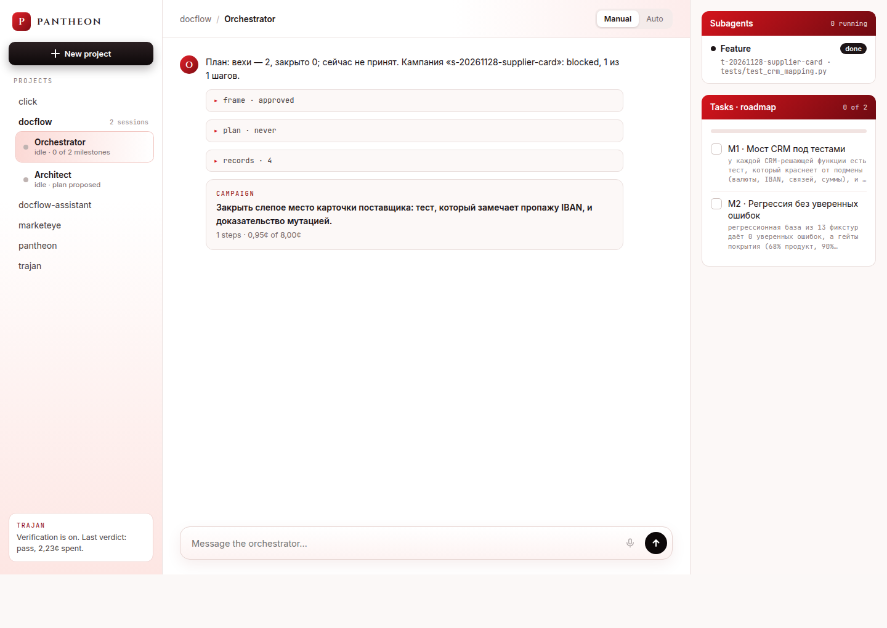

# 13. Экран коробки (workscreen)

Одна локальная страница, которая показывает коробку и разговаривает о ней. Она ничего не
запускает и не правит: действия остаются в CLI и приходят на экран кнопками позже. Решение —
ADR-059.



## Как запустить

```sh
./bin/pantheon ui docflow
```

Команда печатает один адрес с токеном: `http://127.0.0.1:8792/?t=…`. Открывать нужно именно его —
без токена страница не отдаёт данные (403). Чтобы смотреть с другой машины в хвосте (tailnet),
назови адрес явно:

```sh
./bin/pantheon ui docflow --host 100.66.9.103 --port 8793
```

Сервер слушает только названный адрес. Он не поднимается сам, ничего не ставит в систему и не
пишет в проект: остановить его — `Ctrl+C`.

## Что на экране

Слева — проекты (коробки) и две сессии под активной: **Orchestrator** (текущие задачи) и
**Architect** (план, аудит, внедрение нового). Внизу карточка **TRAJAN** с последним вердиктом и
потраченным.

В центре — разговор выбранной сессии: реплики, служебные строки в моноширинном шрифте (рамка,
план, записи, токены ответа), карточка текущей кампании. Внизу — поле ввода с микрофоном (голос —
следующий срез) и кнопкой отправки.

Справа — **Subagents** (шаги кампании: running / queued / done) и **Tasks · roadmap** (вехи плана,
условие закрытия, прогресс).

## Откуда данные

- `harness/ui/state.py` собирает состояние теми же функциями, что `status` и `campaign`, и
  перечитывает диск на каждый запрос: страница не кэширует и не может разойтись с воротами.
- `harness/ui/chat.py` ведёт две нити в томе коробки (`ui/chat/<роль>.json`), ходит на
  OpenAI-совместимый эндпоинт (тот же, что у исполнителя) и считает цену из объявленных ставок;
  нет ставок — цена не называется, а не выдумывается; в коробке `docflow` ставок нет, поэтому ответ
показывает только токены.
- `harness/ui/server.py` — HTTP на стандартной библиотеке: страница, JSON API, токен коробки
  (`ui/token`, 600). Страница и два файла статики открыты без токена (браузер просит их без
  заголовка), данные — только по токену.
- `harness/ui/static/` — страница без сборки: `index.html`, `app.js`, `style.css`, шрифты
  (Cinzel, Inter, JetBrains Mono) лежат рядом, из сети ничего не подгружается.

## Чего пока нет

- **Кнопок действий.** Принять план, принять спеку, запустить шаг, повторить — следующий срез;
  каждая кнопка пойдёт через те же ворота, что CLI.
- **Голосового ввода.** Следующий срез: микрофон запишет WAV и отдаст локальному распознаванию на
  `127.0.0.1:8081` (`/transcribe`), текст ляжет в поле.
- **Агентского цикла.** Разговор советует и объясняет; он не правит файлы и не запускает шаги.
- **Отдельных экранов** для записей и обзора: они остались в CLI (`pantheon records`, `status`) и
  частично видны здесь — в карточке TRAJAN и через разговор.
- **Живой кампании против принятого плана.** Это работа над самим Пантеоном, а не свойство экрана.
