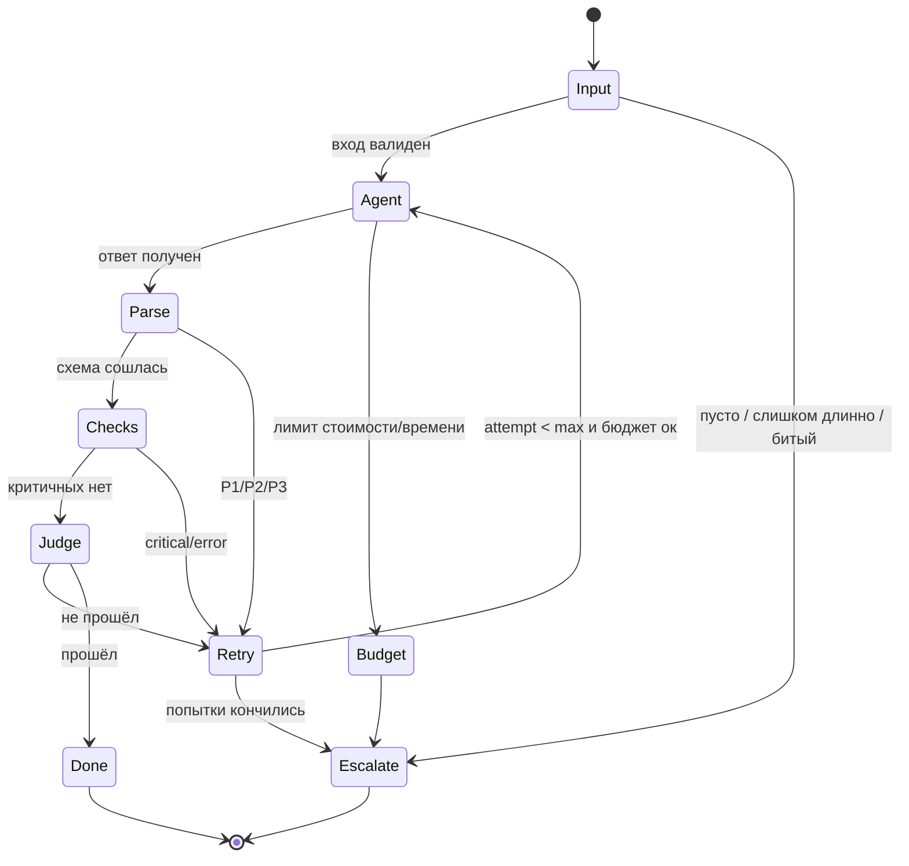

# agentqa — дизайн универсального ядра

Статус: черновик на согласование, код ещё не написан.
Простыми словами: [how-it-works.md](how-it-works.md).

Одна фраза: **`agentqa` — это QA-слой для любого шага LLM-пайплайна, который обязан вернуть
структурированный результат.** Ты оборачиваешь свой агент, приносишь свой пресет (схема, проверки,
рубрика, датасет) — получаешь цикл «проверка → критика → фикс-фидбек → ретрай → эскалация»,
трейс с токенами и стоимостью, и офлайн-регрессию с метриками и отчётом для сравнения версий.

---

## 1. Что это и чем не является

| Это | Это не |
|---|---|
| Библиотека (`pip install agentqa`), встраивается в чужой проект за 20 строк | Агентский фреймворк: не строит графы, не управляет инструментами |
| Обёртка над **любой** функцией `case → structured output` | Привязка к OpenAI/LangChain/вендору |
| Конструктор: ядро = механизм, домен = пресет | Готовая библиотека промптов под конкретную задачу |
| Офлайн-харнесс: датасет, метрики, отчёт, калибровка судьи | SaaS-платформа оценки и дашборд |
| Детерминированные проверки + LLM-критик + цикл коррекции в одном месте | Валидация формата без оценки смысла, или оценка без исправления |

Ключевое ограничение области: **шаг, который возвращает структуру** (JSON/Pydantic). Чат-ответы,
эссе и RAG-ответы вне области — там нет базы для сравнения и цикл коррекции теряет смысл.

---

## 2. Форма продукта: одно ядро, много пресетов


Аналогия для объяснения: принтер и картридж. Ядро — принтер: печатает, считает, показывает ошибки.
Картридж — пресет: в нём твои чернила. Принтер не знает, что печатает.

| Кто владеет | Что |
|---|---|
| Ядро | контракты, цикл, встроенные проверки, трейс, бюджет, метрики, отчёт, CLI, replay |
| Пресет | `output_model`, свои проверки, рубрика и промпт судьи, промпт агента, сборка фидбека, спецификация скоринга, датасет |
| Общее | конфиг (пороги, лимиты, модели) — ядро даёт дефолты, пресет может переопределить |

Пресет — **данные плюс несколько хуков**, а не божественный объект. Минимальный пресет: Pydantic-модель,
пустой список проверок, дефолтная рубрика, датасет. Такой уже работает и ловит форматы и обрывы.

---

## 3. Публичный API

Пять имён, дальше — конфиг. Всё остальное внутреннее.

```python
guarded = agentqa.guard(
    agent=my_agent,              # Callable[[Case, Feedback | None], Awaitable[Attempt]]
    preset=LOGISTICS_PRESET,     # Preset
    llm=openai_compatible(...),  # LLMClient (для судьи); FakeClient в тестах
    config=QAConfig(),           # лимиты, пороги, режим
)

result = await guarded.run(case)             # RunResult[Intake]
report = await agentqa.evaluate(guarded, dataset)   # EvalReport
agentqa.report.write_markdown(report, "reports/run.md")
agentqa.compare(baseline_json, guarded_json)        # ReportDiff
agentqa.calibrate(guarded, labels)                  # MetaEval
```

Почему фасад, а не «собери сам из пяти классов»: сценарий использования должен читаться в одну
строку, иначе библиотека не приживается. Внутренние компоненты при этом остаются доступными —
фасад композирует, а не прячет.

### Контракты (Pydantic v2)

Общая база: `extra="forbid"`, `frozen=True`, `str_strip_whitespace=True`.

**Вход**

```python
JsonValue = str | int | float | bool | None | list["JsonValue"] | dict[str, "JsonValue"]

class Case(StrictModel):
    case_id: str
    payload: JsonValue            # сырой вход: письмо, диалог, документ, аргументы вызова
    meta: dict[str, str] = {}
```

**Агент и его ответ**

```python
class Feedback(StrictModel):
    attempt: int
    issues: list[Issue]
    judge: JudgeVerdict | None
    instructions: list[str]       # готовые императивные указания для агента

Attempt = BaseModel | dict[str, JsonValue] | str   # последнее — текст, который придётся парсить

AgentFn = Callable[[Case, Feedback | None], Awaitable[Attempt]]
```

`Feedback` — единственный способ ядра говорить с пользовательским агентом. Пресет может
переопределить, как он превращается в сообщения (`build_retry`), но структура фидбека — контракт
ядра, поэтому трейс и метрики одинаковы для всех доменов.

**Проблемы и вердикты**

```python
Severity = Literal["info", "warning", "error", "critical"]
IssueSource = Literal["input", "parse", "check", "judge", "budget"]

class Issue(StrictModel):
    code: str = Field(pattern=r"^[A-Z][A-Z0-9_]{2,40}$")   # G2_BAD_COUNTRY, C_EVIDENCE_MISSING
    severity: Severity
    source: IssueSource
    field_path: str | None = None
    message: str = Field(max_length=500)
    hint: str | None = Field(default=None, max_length=300)  # что сделать вместо этого
    details: dict[str, JsonValue] = {}

class CheckResult(StrictModel):
    check_id: str
    passed: bool
    issues: list[Issue]
    duration_ms: float

class GateResult(StrictModel):
    passed: bool
    results: list[CheckResult]        # по одному на проверку — видно, кто промолчал
    issues: list[Issue]

class Criterion(StrictModel):
    id: str
    title: str
    description: str
    weight: float = Field(gt=0, le=1)

class Rubric(StrictModel):
    criteria: list[Criterion]
    pass_score: float = Field(default=0.75, ge=0, le=1)
    blocking: set[Severity] = {"error", "critical"}
    def weighted_score(self, scores: dict[str, int]) -> float: ...   # 1..5 → 0..1

class JudgeVerdict(StrictModel):
    passed: bool                      # ВСЕГДА пересчитывает ядро, не модель
    score: float
    criterion_scores: dict[str, int]  # по id из рубрики, 1..5
    issues: list[Issue]
    fix_instructions: list[str] = Field(max_length=5)
    must_escalate: bool = False
    confidence: float = Field(ge=0, le=1)
```

**Трейс и результат**

```python
Stage = Literal["input", "agent", "parse", "check", "judge", "retry", "escalate", "done"]

class Usage(StrictModel):
    model: str
    prompt_tokens: int
    completion_tokens: int
    cost_usd: float
    latency_ms: float
    cached: bool = False

class TraceEvent(StrictModel):
    attempt: int
    stage: Stage
    ok: bool
    duration_ms: float
    usage: Usage | None = None
    payload_sha256: str | None = None   # тело не храним: трейс не должен разрастаться
    notes: str | None = None

class Totals(StrictModel):
    latency_ms: float
    attempts: int
    prompt_tokens: int
    completion_tokens: int
    cost_usd: float
    judge_calls: int

Status = Literal["passed", "passed_after_retry", "escalated", "failed"]

class RunResult(StrictModel, Generic[TOut]):
    case_id: str
    mode: Literal["baseline", "guarded"]
    status: Status
    output: TOut | None               # последняя версия, даже если эскалация
    gate: GateResult | None
    verdict: JudgeVerdict | None
    escalation_reason: EscalationReason | None
    trace: list[TraceEvent]
    totals: Totals
```

`RunResult[Intake]` — генерический по выходу пресета: типизация работает сквозь всю библиотеку,
пользователь получает свой тип, а не `dict`.

**Датасет и отчёт**

```python
class FieldSpec(StrictModel):
    path: str                                        # "shipment.origin.country_code"
    comparator: Literal["exact","normalized","fuzzy","set","numeric"] = "normalized"
    weight: float = 1.0
    tolerance: float | None = None

class Trap(StrictModel):
    path: str
    forbidden: list[JsonValue]
    reason: str

class ScoringSpec(StrictModel):
    fields: list[FieldSpec]
    traps: list[Trap] = []
    min_field_accuracy: float | None = None   # жёсткий порог «кейс не прошёл»

class EvalCase(StrictModel):
    case_id: str
    category: Literal["happy_path", "edge_case", "adversarial"]
    tags: list[str] = []
    payload: JsonValue
    expected: dict[str, JsonValue]
    traps: list[Trap] = []
    human_verdict: bool | None = None         # для калибровки судьи
    notes: str | None = None

class Metrics(StrictModel):
    cases: int
    pass_rate_first_attempt: float
    pass_rate_final: float
    retry_rate: float
    retry_recovery_rate: float
    escalation_rate: float
    field_accuracy_macro: float
    hallucination_rate: float
    latency_p50_ms: float
    latency_p95_ms: float
    prompt_tokens: int
    completion_tokens: int
    cost_usd_total: float
    cost_usd_per_case: float
    cost_usd_per_passed_case: float
    by_category: dict[str, CategoryMetrics]

class EvalReport(StrictModel):
    run_id: str
    created_at: datetime
    git_sha: str
    mode: Literal["baseline", "guarded"]
    preset_name: str
    preset_hash: str          # схема + проверки + рубрика + промпты
    dataset_hash: str
    llm: dict[str, str]       # модели, температуры, лимиты
    metrics: Metrics
    meta_eval: MetaEval | None
    cases: list[CaseResult]
```

`preset_hash` — не украшение: без него нельзя доказать, что два отчёта отличаются **только** версией
пресета, и сравнение версий превращается в разговор о погоде.

---

## 4. Цикл выполнения



Правила, зашитые в ядро (не конфигурируются, потому что это и есть смысл библиотеки):

1. **Дешёвое раньше дорогого.** Проверки идут по `tier`: `fast` (без сети, миллисекунды) до
   `deep`. Судья вызывается только если быстрые не заблокировали — либо по политике пресета.
2. **Критичное останавливает цикл.** `critical` (небезопасный PII, обрыв ответа, отказ модели) не
   лечится ретраем: это `escalated` сразу, экономия денег и времени.
3. **Фиксированный бюджет.** `max_attempts` (по умолчанию 2), `max_cost_usd`, `max_latency_ms`.
   Исчерпание бюджета — `escalated` с причиной `budget_exhausted`, а не исключение.
4. **Никаких ретраев без нового знания.** Если второй ответ совпал с первым (нормализованное
   сравнение `payload_sha256`), третий вызов бессмысленен → `escalated: no_progress`.
5. **Результат неизменяем.** `RunResult` — свидетельство: frozen, с хешами шагов.
6. **Никаких тихих падений.** Любое исключение агента/парсера/провайдера превращается в `Issue`
   с кодом и попадает в трейс.

Порядок и состав проверок — из пресета, но ядро сортирует их по `tier`, а не в порядке объявления:
иначе пользователь случайно поставит дорогую проверку перед дешёвой.

### Режимы

| Режим | Что делает | Зачем |
|---|---|---|
| `guarded` | полный цикл | рабочий режим |
| `baseline` | один вызов агента, парсинг, без проверок и судьи | точка сравнения для отчёта |
| `shadow` | полный цикл, но результат всё равно не блокирует (только трейс) | безопасное включение на живом трафике |

`shadow` — то, чего обычно не хватает при внедрении: посмотреть, что было бы, прежде чем кого-то
блокировать. Стоит 20 строк, а снимает половину возражений «а вдруг он зарежет нормальные заявки».

---

## 5. Каталог встроенных проверок (доменно-нейтральные)

Контракт проверки:

```python
class Check(Protocol):
    id: str
    tier: Literal["fast", "deep"]
    def __call__(self, output: BaseModel, ctx: CheckContext) -> list[Issue]: ...
```

Чистая функция: без сети, без состояния, без времени (`now` приходит в `CheckContext`, чтобы тесты
были детерминированными). `deep` разрешён к сети, но встроенные `deep`-проверок не имеют — только
пользовательские (например, сверка с базой тарифов).

| id | Код(ы) | Что ловит | Настройка |
|---|---|---|---|
| `parse` | `P1_BAD_JSON`, `P2_SCHEMA`, `P3_TRUNCATED` | не JSON, схема не сошлась, ответ обрезан по лимиту | — |
| `required` | `G1_REQUIRED_MISSING` | обязательные поля, условно обязательные (`required_when`) | список правил |
| `formats` | `G2_BAD_*` | страна/валюта/дата/email/телефон/URL/enum по реестрам ISO | какие поля проверять |
| `ranges` | `G3_OUT_OF_RANGE` | числа вне границ, даты в прошлом/будущем | границы по путям |
| `evidence` | `G4_NO_EVIDENCE`, `G4_FAKE_QUOTE` | значение без цитаты; цитаты нет в исходнике | `evidence_paths`, порог похожести |
| `pii` | `G5_PII_LEAK` | email/телефон/карта/IBAN там, где политика запрещает | что запрещено и где |
| `refusal` | `G6_REFUSAL` | модель отказалась отвечать, вместо структуры | маркеры отказа |
| `duplicates` | `G7_DUPLICATE_ITEMS` | дубли в списках (двойной счёт груза) | ключ сравнения |
| `consistency` | свой код | кросс-полевые предикаты: `lambda o: o.a <= o.b` | список правил с кодом и текстом |

Почему именно эти: они доменно-нейтральны и покрывают большинство провалов структурированного
вывода. Всё доменное («холодильник требует температурного режима») живёт в `consistency` у пресета —
одной лямбдой с кодом и подсказкой, а не новым классом.

`evidence` — единственная «умная» встроенная проверка, и она опциональна: включается, если пресет
объявил `evidence_paths`. Обоснование — в [how-it-works.md](how-it-works.md) (решение U7), здесь коротко:
цитата превращает «модель вроде не придумала» в проверяемый факт за ноль токенов.

---

## 6. Судья

```python
class JudgePolicy(StrictModel):
    enabled: bool = True
    mode: Literal["always", "on_gate_pass", "sampled", "gates_failed_only"] = "on_gate_pass"
    sample_rate: float = Field(default=1.0, gt=0, le=1)
    model: str | None = None          # None → модель агента
    max_input_chars: int = 20_000

class LLMJudge:
    def __init__(self, llm: LLMClient, rubric: Rubric, instructions: str): ...
    async def review(self, case: Case, output: BaseModel, gate: GateResult) -> JudgeVerdict: ...
```

Решения, которые делают судью предсказуемым:

- **Рубрика — данные**, а не кусок текста в промпте: критерии с весами и описаниями. Из неё
  генерируется и промпт, и формула оценки. Меняется рубрика — меняется `preset_hash`, и отчёт
  честно показывает, что версия другая.
- **`passed` считает код** по весам. Модель даёт только 1..5 по критериям и `issues`.
- **Судья не видит рассуждений агента** — только вход и результат. Иначе он соглашается с
  обоснованием, а не проверяет факт.
- **Сэмплирование** (`sampled`, `sample_rate`): на потоке можно проверять 10% кейсов судьёй,
  оставив гейты на 100%. Это единственный способ сделать runtime-QA дешёвым на объёме, и это
  осознанный компромисс, а не забытая опция.
- **`FunctionJudge`** — тот же интерфейс без LLM: для тестов ядра и для детерминированных
  «судей» (например, сверка с эталонной таблицей).

---

## 7. Коррекция и эскалация

```python
class RetryPolicy(StrictModel):
    max_attempts: int = Field(default=2, ge=1, le=3)
    retry_on: set[Severity] = {"error", "critical"}
    include_previous_output: bool = True
    include_failing_quotes: bool = True      # для evidence: показать, что не нашлось
    temperature_boost: float = 0.0           # 0 = не менять

class EscalationPolicy(StrictModel):
    on_exhausted: Literal["escalate", "return_last"] = "escalate"
    on_critical: Literal["escalate", "retry_once"] = "escalate"
    on_budget: Literal["escalate", "return_last"] = "escalate"

EscalationReason = Literal[
    "max_attempts_exhausted", "critical_issue", "budget_exhausted",
    "no_progress", "input_invalid", "judge_escalate", "agent_error",
]
```

Формат фидбека по умолчанию (шаблон в `prompts/correction_default.md`, пресет может заменить):
исходный вход, прошлый результат, список `issues` с путями и подсказками, `fix_instructions`, и
явное «не добавляй того, чего нет во входе; неизвестное помечай, а не угадывай».

Дефолт намеренно «сухой»: конкретика («поле `x` не подтверждено») работает лучше вежливых
рассуждений («пожалуйста, проверьте внимательнее»). Это же требование к пресету: `fix_instructions`
должны быть императивными и узкими.

---

## 8. Офлайн-оценка

Поток: `dataset.jsonl` → `evaluate()` → `EvalReport` (JSON) → `report.write_markdown()` → коммитим
пример в `reports/`. Сравнение версий — `compare(two reports) → ReportDiff`: таблица «baseline /
guarded / Δ» по метрикам плюс список кейсов, сменивших статус, с кодами причин.

```python
class ReportDiff(StrictModel):
    a: str                              # run_id
    b: str
    metrics: dict[str, MetricDelta]     # a_value, b_value, delta, direction_is_good
    changed_cases: list[CaseChange]     # case_id, from_status, to_status, failure_codes
    preset_hash_changed: bool
    dataset_hash_changed: bool
```

`preset_hash_changed` / `dataset_hash_changed` — красные флаги в отчёте: если они взлетели, сравнение
метрик некорректно (изменили не только код). Библиотека обязана это сказать сама, а не надеяться на
внимательность читателя.

Метрики — те же, что в §3, плюс `meta_eval`:

```python
class MetaEval(StrictModel):
    n: int
    agreement: float
    cohens_kappa: float
    judge_precision: float
    judge_recall: float
    false_pass_ids: list[str]     # судья пропустил брак — самый дорогой класс ошибки
    false_fail_ids: list[str]
```

Калибровка — командой `agentqa calibrate --preset ... --labels ...`: прогоняет судью по размеченным
кейсам и печатает таблицу. Это не «доверие модели», а измерение.

---

## 9. Пакет, зависимости, совместимость

- `pydantic>=2.7` — единственная обязательная зависимость. Всё остальное — extras.
- `httpx` вместо вендорских SDK: один клиент на OpenAI-совместимые API (OpenAI, DeepSeek,
  OpenRouter, локальный llama.cpp) и один на Anthropic. Меньше зависимостей, полный контроль над
  таймаутами и повторами, и видно, что именно уходит в сеть.
- CLI на `argparse` (stdlib), без `typer`/`click`: три команды, экономия зависимостей.
- Python ≥ 3.11 (`asyncio.TaskGroup`, `Self`, `tomllib`).
- SemVer; `contracts/` — стабильная часть, `runtime/` — внутренняя. Любое ломающее изменение
  контракта — мажор.

```
agentqa/
├── pyproject.toml            # hatchling, extras: openai, anthropic, dev
├── README.md                 # EN: проблема → идея → 20 строк использования → отчёт
├── LICENSE                   # MIT
├── Makefile                  # test / lint / typecheck / eval-mock / report
├── .github/workflows/ci.yml  # ruff + mypy + pytest, без секретов
├── src/agentqa/
│   ├── __init__.py           # guard, evaluate, compare, calibrate
│   ├── cli.py
│   ├── config.py             # QAConfig, RunLimits, RetryPolicy, JudgePolicy, PRICES
│   ├── contracts/            # base, case, issues, verdict, rubric, trace, evals
│   ├── checks/               # base, registry, parse, required, formats, ranges,
│   │                         # evidence, pii, refusal, duplicates, consistency
│   ├── judge/                # base, llm_judge, function_judge, calibration, prompts/
│   ├── llm/                  # base, fake, replay, openai_compatible, anthropic, pricing
│   ├── runtime/              # facade, loop, correction, escalation, budget, modes
│   ├── tracing/              # base, jsonl, callback, null
│   ├── evals/                # dataset, scoring, metrics, report, compare, runner
│   └── presets/toy.py        # игрушечный пресет для тестов ядра
├── examples/logistics_intake/
│   ├── preset.py             # схема, проверки, рубрика, промпт — витрина «как наполнять»
│   ├── agent.py              # демо-агент (prompt → LLM → JSON)
│   ├── data/*.jsonl          # 32 кейса + 18 ручных вердиктов
│   └── README.md
├── tests/
│   ├── unit/                 # по проверке, скоринг, метрики, рубрика, бюджет
│   ├── integration/          # цикл на FakeClient: pass / retry-recover / escalate / budget
│   ├── regression/test_golden_report.py
│   └── cassettes/
├── reports/sample_report.md  # закоммиченный пример сравнения
└── docs/                     # design.md, how-it-works.md, checks_catalog.md,
                              # extending.md, judge_rubric.md, failure_taxonomy.md
```

Почему `src/`-layout и отдельный `examples/`: `examples/` не устанавливается в пакет, но живёт в
репозитории и в CI — иначе витрина сгниёт за месяц.

---

## 10. Три уровня кастомизации

| Уровень | Что делаешь | Кода | Когда хватает |
|---|---|---|---|
| L1 | правишь `QAConfig`: лимиты, пороги, какие проверки включены, модель судьи | ноль | 80% случаев |
| L2 | пишешь свои `Check` и `consistency`-правила, добавляешь `evidence_paths`, свою рубрику | 10–50 строк | доменные правила |
| L3 | свой `AgentFn`, свой `Judge`, свой `TraceSink`, свой пресет целиком, свои метрики | как угодно | нестандартный пайплайн |

Правило проектирования: L1 не требует чтения исходников, L2 не требует форка, L3 не требует
переписывания ядра. Если кастомизация требует форка — это баг ядра.

---

## 11. Тестирование без токенов

- `FakeClient`: ответы из фикстур, включая битый JSON, обрыв и отказ.
- `FunctionJudge` для интеграционных тестов цикла.
- Кассеты: запись реальных ответов (`--record`) и воспроизведение (`--replay`) — прогоны
  воспроизводимы без ключей и денег.
- Регрессия отчёта: `test_golden_report.py` фиксирует метрики прогона на синтетическом датасете;
  изменение поведения ловится как падение теста, а не как «на глаз».
- Снапшоты JSON Schema контрактов: ломающее изменение видно в диффе PR.

---

## 12. Фазы и приёмка

| Фаза | Содержимое | Приёмка |
|---|---|---|
| 0 | доки, README-заглушка | этот файл согласован |
| 1 | скелет, `pyproject`, `contracts/`, `config`, CI | `pytest -q` зелёный на контрактах, `ruff`/`mypy` чистые |
| 2 | встроенные проверки + тесты на каждый код | на каждый код: «ловит» и «не ложно срабатывает» |
| 3 | `llm/` (fake, replay, openai-compatible, anthropic) + pricing | интеграция с FakeClient без сети |
| 4 | судья, рубрика, подсчёт score кодом, `calibrate` | тест: судья не может «объявить себя пройденным» |
| 5 | цикл: попытки, бюджет, режимы, эскалации, трейс | 4 сценария: pass / recover / escalate / budget |
| 6 | evals: датасет, скоринг, метрики, отчёт, сравнение | `eval --replay` даёт отчёт без сети |
| 7 | `presets/toy` + `examples/logistics_intake` + README | пример проходит, README читается за 2 минуты |
| 8 | реальный прогон, кассеты, цифры в README, бейджи | цифры воспроизводятся из кассет |

---

## 13. Открытые вопросы

1. **Имя пакета на PyPI.** `agentqa` может быть занято — проверить перед публикацией; имя репозитория
   от этого не зависит.
2. **Дефолтная модель судьи.** Предлагаю: та же, что у агента; в README — пример «сильнее модель
   только для судьи» и как это отражается на стоимости.
3. **`sample_rate` по умолчанию.** Предлагаю 1.0 (честный дефолт), с рецептом для потока в docs.
4. **Хранить ли тела промптов в трейсе.** Предлагаю: нет (только хеши + опциональный
   `capture_payloads=True` для отладки), чтобы трейс не разрастался и не содержал PII.
