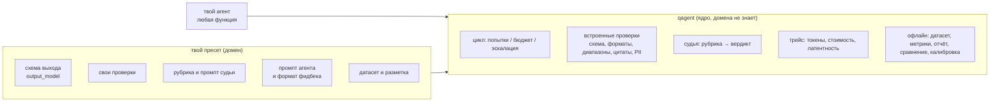
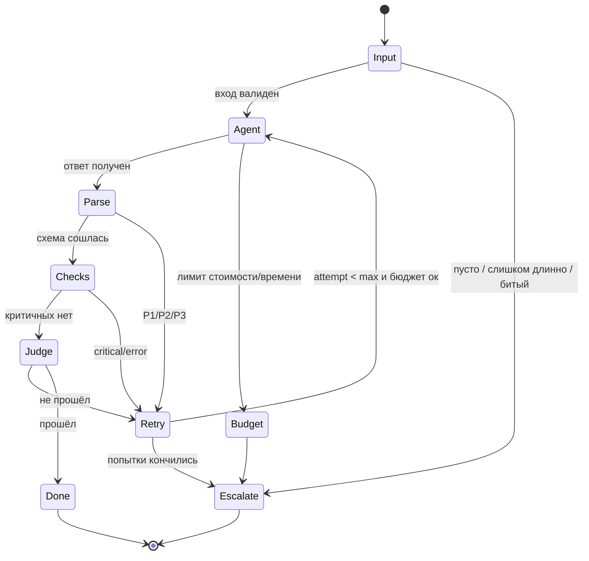

# qagent — дизайн ядра

Статус: ядро оценки построено и покрыто тестами (фазы 0–11 истории проекта). Куда проект идёт
дальше — контур независимой проверки — описано в [roadmap.md](roadmap.md); этот документ
объясняет решения, на которых стоит уже работающее ядро, и не переписывается при смене
направления.
Простыми словами: [how-it-works.md](how-it-works.md).

Одна фраза: **`qagent` — это QA-слой для любого шага LLM-пайплайна, который обязан вернуть
структурированный результат.** Ты оборачиваешь свой агент, приносишь свой пресет (схема, проверки,
рубрика, датасет) — получаешь цикл «проверка → критика → фикс-фидбек → ретрай → эскалация»,
трейс с токенами и стоимостью, и офлайн-регрессию с метриками и отчётом для сравнения версий.

---

## 1. Что это и чем не является

| Это | Это не |
|---|---|
| Библиотека (`pip install -e .`, пока не на PyPI), встраивается в чужой проект за 20 строк | Агентский фреймворк: не строит графы, не управляет инструментами |
| Обёртка над **любой** функцией `case → structured output` | Привязка к OpenAI/LangChain/вендору |
| Конструктор: ядро = механизм, домен = пресет | Готовая библиотека промптов под конкретную задачу |
| Офлайн-харнесс: датасет, метрики, отчёт, калибровка судьи | SaaS-платформа оценки и дашборд |
| Детерминированные проверки + LLM-критик + цикл коррекции в одном месте | Валидация формата без оценки смысла, или оценка без исправления |

Ключевое ограничение области: **шаг, который возвращает структуру** (JSON/Pydantic). Чат-ответы,
эссе и RAG-ответы вне области — там нет базы для сравнения и цикл коррекции теряет смысл.

---

## 2. Форма продукта: одно ядро, много пресетов



Аналогия для объяснения: принтер и картридж. Ядро — принтер: печатает, считает, показывает ошибки.
Картридж — пресет: в нём твои чернила. Принтер не знает, что печатает.

| Кто владеет | Что |
|---|---|
| Ядро | контракты, цикл, встроенные проверки, трейс, бюджет, метрики, отчёт, CLI, replay |
| Пресет | `output_model`, свои проверки, рубрика и промпт судьи, промпт агента, сборка фидбека, спецификация скоринга, датасет |
| Общее | конфиг (пороги, лимиты, модели) — ядро даёт дефолты, пресет может переопределить |

Пресет — **данные плюс несколько хуков**, а не божественный объект. Минимальный пресет: Pydantic-модель,
пустой список проверок, дефолтная рубрика, датасет. Такой уже работает и ловит форматы и обрывы.

---

## 3. Публичный API

Фасад и несколько функций, дальше — конфиг. Всё остальное внутреннее.

```python
guarded = qagent.guard(
    agent=my_agent,              # Callable[[Case, Feedback | None], Awaitable[Attempt]]
    preset=LOGISTICS_PRESET,     # Preset
    llm=openai_compatible(...),  # LLMClient (для судьи); FakeClient в тестах
    config=QAConfig(),           # лимиты, пороги, режим
)

result = await guarded.run(case)                    # RunResult[Intake]
report = await qagent.evaluate(guarded, dataset)   # EvalReport (+ meta_eval при метках)
qagent.report.write_json(report, "reports/run.json")
qagent.report.write_markdown(report, "reports/run.md")
qagent.compare(baseline_json, guarded_json)        # ReportDiff
```

Отдельная калибровка судьи (`qagent.calibrate(judge, labelled)`) остаётся доступной, но в обычном
прогоне её делать не нужно: если в датасете есть `human_verdict`, `evaluate()` сам кладёт `meta_eval`
в отчёт.

Почему фасад, а не «собери сам из пяти классов»: сценарий использования должен читаться в одну
строку, иначе библиотека не приживается. Внутренние компоненты при этом остаются доступными —
фасад композирует, а не прячет.

### Контракты (Pydantic v2)

Общая база: `extra="forbid"`, `frozen=True`, `str_strip_whitespace=True`.

**Вход**

```python
JsonValue = str | int | float | bool | None | list["JsonValue"] | dict[str, "JsonValue"]

class Case(StrictModel):
    case_id: str
    payload: JsonValue            # сырой вход: письмо, диалог, документ, аргументы вызова
    meta: dict[str, str] = {}
```

**Агент и его ответ**

```python
class Feedback(StrictModel):
    attempt: int
    issues: list[Issue]
    judge: JudgeVerdict | None
    instructions: list[str]       # готовые императивные указания для агента
    previous_output: str | None   # отклонённый ответ: без него фикс — угадайка

Attempt = BaseModel | dict[str, JsonValue] | str   # последнее — текст, который придётся парсить

@dataclass(frozen=True)
class AgentReply:
    attempt: Attempt
    usages: tuple[Usage, ...] = ()
    truncated: bool = False

AgentFn = Callable[[Case, Feedback | None], Awaitable[Attempt | AgentReply]]
```

`Feedback` — единственный способ ядра говорить с пользовательским агентом, поэтому прошлый ответ
входит в контракт: агент вызывается как функция и иначе не увидел бы, что именно сломал. `AgentReply`
нужен только агентам, которые хотят попасть в трейс и бюджет своими токенами; простой
детерминированный агент возвращает `Attempt`.

**Пресет**

```python
class Preset(Generic[TOut]):
    name: str
    output_model: type[TOut]
    rubric: Rubric
    checks: Sequence[Check] = ()
    judge: Judge | None = None            # можно не давать: фасад соберёт LLMJudge по политике
    scoring: ScoringSpec | None = None    # для офлайн-прогона
    agent_prompt: str = ""                # пресет отдаёт его своему агенту, ядро не читает
    judge_instructions: str = ""          # доменные правила для судьи
    agent_model: str | None = None        # фолбэк для модели судьи и метаданные отчёта
    build_retry: Callable[[Case, Feedback], Feedback] | None = None
    validate_input: Callable[[Case], list[Issue]] | None = None

    def fingerprint(self) -> str: ...     # sha256 схемы, проверок, рубрики, промптов, скоринга
```

Пресет — обычный frozen dataclass, а не Pydantic-модель: два его поля непроверяемы по природе (класс
схемы и функции-хуки), и проверять внешний слой, делая вид, что внутренний тоже проверен, хуже, чем
проверить то, что можно: непустое имя, `BaseModel`-схема, уникальные id проверок.

`fingerprint()` хеширует `id` и `tier` проверок, а не их настройки: протокол проверки конфигурацию не
раскрывает. Если своя проверка меняет поведение при том же id, пресет переопределяет `fingerprint`.

**Проблемы и вердикты**

```python
Severity = Literal["info", "warning", "error", "critical"]
IssueSource = Literal["input", "parse", "check", "judge", "budget"]

class Issue(StrictModel):
    code: str = Field(pattern=r"^[A-Z][A-Z0-9_]{2,40}$")   # G2_BAD_COUNTRY, C_EVIDENCE_MISSING
    severity: Severity
    source: IssueSource
    field_path: str | None = None
    message: str = Field(max_length=500)
    hint: str | None = Field(default=None, max_length=300)  # что сделать вместо этого
    details: dict[str, JsonValue] = {}

class CheckResult(StrictModel):
    check_id: str
    passed: bool
    issues: list[Issue]
    duration_ms: float

class GateResult(StrictModel):
    passed: bool
    results: list[CheckResult]        # по одному на проверку — видно, кто промолчал
    issues: list[Issue]

class Criterion(StrictModel):
    id: str
    title: str
    description: str
    weight: float = Field(gt=0, le=1)

class Rubric(StrictModel):
    criteria: list[Criterion]
    pass_score: float = Field(default=0.75, ge=0, le=1)
    blocking: set[Severity] = {"error", "critical"}
    def weighted_score(self, scores: dict[str, int]) -> float: ...   # 1..5 → 0..1

class JudgeVerdict(StrictModel):
    passed: bool                      # ВСЕГДА пересчитывает ядро, не модель
    score: float
    criterion_scores: dict[str, int]  # по id из рубрики, 1..5
    issues: list[Issue]
    fix_instructions: list[str] = Field(max_length=5)
    must_escalate: bool = False
    confidence: float = Field(ge=0, le=1)
```

**Трейс и результат**

```python
Stage = Literal["input", "agent", "parse", "check", "judge", "retry", "escalate", "done"]

class Usage(StrictModel):
    model: str
    prompt_tokens: int
    completion_tokens: int
    cost_usd: float
    latency_ms: float
    cached: bool = False

class TraceEvent(StrictModel):
    attempt: int
    stage: Stage
    ok: bool
    duration_ms: float
    usage: Usage | None = None
    payload_sha256: str | None = None   # тело не храним: трейс не должен разрастаться
    notes: str | None = None

class Totals(StrictModel):
    latency_ms: float
    attempts: int                     # 0, если вход отвергнут до вызова агента
    prompt_tokens: int
    completion_tokens: int
    cost_usd: float
    judge_calls: int

Status = Literal["passed", "passed_after_retry", "escalated", "failed"]

class RunResult(StrictModel, Generic[TOut]):
    case_id: str
    mode: Literal["baseline", "guarded", "shadow"]
    status: Status
    output: TOut | None               # последняя версия, даже если эскалация
    gate: GateResult | None
    verdict: JudgeVerdict | None
    escalation_reason: EscalationReason | None
    would_have_blocked: bool | None   # только shadow: что сделал бы guarded
    trace: list[TraceEvent]
    totals: Totals

    @property
    def blocking(self) -> bool: ...   # False в shadow, иначе status ∈ {escalated, failed}
```

`RunResult[Intake]` — генерический по выходу пресета: типизация работает сквозь всю библиотеку,
пользователь получает свой тип, а не `dict`.

**Датасет и отчёт**

```python
class FieldSpec(StrictModel):
    path: str                                        # "shipment.origin.country_code"
    comparator: Literal["exact","normalized","fuzzy","set","numeric"] = "normalized"
    weight: float = 1.0
    tolerance: float | None = None

class Trap(StrictModel):
    path: str
    forbidden: list[JsonValue]
    reason: str

class ScoringSpec(StrictModel):
    fields: list[FieldSpec]
    traps: list[Trap] = []
    min_field_accuracy: float | None = None   # жёсткий порог «кейс не прошёл»

class EvalCase(StrictModel):
    case_id: str
    category: Literal["happy_path", "edge_case", "adversarial"]
    tags: list[str] = []
    payload: JsonValue
    expected: dict[str, JsonValue]
    traps: list[Trap] = []
    human_verdict: bool | None = None         # для калибровки судьи
    notes: str | None = None

class Metrics(StrictModel):
    cases: int
    pass_rate_first_attempt: float
    pass_rate_final: float
    retry_rate: float
    retry_recovery_rate: float
    escalation_rate: float
    field_accuracy_macro: float
    hallucination_rate: float
    latency_p50_ms: float
    latency_p95_ms: float
    prompt_tokens: int
    completion_tokens: int
    cost_usd_total: float
    cost_usd_per_case: float
    cost_usd_per_passed_case: float
    by_category: dict[str, CategoryMetrics]

class EvalReport(StrictModel):
    run_id: str
    created_at: datetime
    git_sha: str
    mode: Literal["baseline", "guarded"]
    preset_name: str
    preset_hash: str          # схема + проверки + рубрика + промпты
    dataset_hash: str
    llm: dict[str, str]       # модели, температуры, лимиты
    metrics: Metrics
    meta_eval: MetaEval | None
    cases: list[CaseResult]
```

`preset_hash` — не украшение: без него нельзя доказать, что два отчёта отличаются **только** версией
пресета, и сравнение версий превращается в разговор о погоде.

---

## 4. Цикл выполнения



Правила, зашитые в ядро (не конфигурируются, потому что это и есть смысл библиотеки):

1. **Дешёвое раньше дорогого.** Проверки идут по `tier`: `fast` (без сети, миллисекунды) до
   `deep`. Судья вызывается только если быстрые не заблокировали — либо по политике пресета.
2. **Критичное останавливает цикл.** `critical` (небезопасный PII, обрыв ответа, отказ модели) не
   лечится ретраем: это `escalated` сразу, экономия денег и времени.
3. **Фиксированный бюджет.** `max_attempts` (по умолчанию 2), `max_cost_usd`, `max_latency_ms`.
   Исчерпание бюджета — `escalated` с причиной `budget_exhausted`, а не исключение.
4. **Никаких ретраев без нового знания.** Если второй ответ совпал с первым (нормализованное
   сравнение `payload_sha256`), третий вызов бессмысленен → `escalated: no_progress`.
5. **Результат неизменяем.** `RunResult` — свидетельство: frozen, с хешами шагов.
6. **Никаких тихих падений.** Любое исключение агента/парсера/провайдера превращается в `Issue`
   с кодом и попадает в трейс.

Порядок и состав проверок — из пресета, но ядро сортирует их по `tier`, а не в порядке объявления:
иначе пользователь случайно поставит дорогую проверку перед дешёвой.

### Режимы

| Режим | Что делает | Зачем |
|---|---|---|
| `guarded` | полный цикл | рабочий режим |
| `baseline` | один вызов агента, парсинг, без проверок и судьи | точка сравнения для отчёта |
| `shadow` | полный цикл, но результат всё равно не блокирует (только трейс) | безопасное включение на живом трафике |

`shadow` — то, чего обычно не хватает при внедрении: посмотреть, что было бы, прежде чем кого-то
блокировать. Стоит 20 строк, а снимает половину возражений «а вдруг он зарежет нормальные заявки».

Точные правила, чтобы режимы не расходились в отчётах:

- `baseline` — **ровно один** вызов агента плюс парсинг. Статус честный: `passed`, если ответ
  разобрался, иначе `failed` с гейтом из `parse`-issues. Это знаменатель для сравнения, а не
  «режим без качества».
- `shadow` проходит тот же цикл и оставляет тот же статус; отличаются только `blocking` (всегда
  `False`) и поле `would_have_blocked`. Подменять статус на `passed` нельзя: тогда отчёт по shadow
  нельзя будет сравнить с отчётом по guarded.

Ещё три правила цикла:

- **Бюджет гейтит новые траты.** Проверка перед каждым вызовом агента и перед вызовом судьи. Если
  попытка уже принесла проходящий результат, он возвращается: выбрасывать оплаченный хороший ответ
  из-за пересечённого лимита бессмысленно.
- **`no_progress` — до судьи.** Совпавший ответ пройдёт те же проверки с тем же итогом, а судья —
  это лишние деньги.
- **Сломанный судья не пропускает результат.** Качество неизвестно → `escalated: judge_escalate`.
  Молчаливый пропуск сделал бы библиотеку опасной ровно в момент поломки.

---

## 5. Каталог встроенных проверок (доменно-нейтральные)

Контракт проверки:

```python
class Check(Protocol):
    @property
    def id(self) -> str: ...
    @property
    def tier(self) -> Literal["fast", "deep"]: ...
    def __call__(self, output: BaseModel, ctx: CheckContext) -> list[Issue]: ...
```

`id` и `tier` — только для чтения: встроенные проверки заморожены, и протокол с сеттером отвергал бы
собственные классы библиотеки (решение U27).

Чистая функция: без сети, без состояния, без времени (`now` приходит в `CheckContext`, чтобы тесты
были детерминированными). `deep` разрешён к сети, но встроенные `deep`-проверок не имеют — только
пользовательские (например, сверка с базой тарифов).

| id | Код(ы) | Что ловит | Настройка |
|---|---|---|---|
| `parse` | `P1_BAD_JSON`, `P2_SCHEMA`, `P3_TRUNCATED` | не JSON, схема не сошлась, ответ обрезан по лимиту | — (живёт в `parsing.py`, до гейта: проверять ещё нечего) |
| `required` | `G1_REQUIRED_MISSING` | обязательные поля, условно обязательные (`required_when`) | список правил |
| `formats` | `G2_BAD_*` | страна/валюта/дата/email/телефон/URL/enum по реестрам ISO | какие поля проверять |
| `ranges` | `G3_OUT_OF_RANGE` | числа вне границ, даты в прошлом/будущем | границы по путям |
| `evidence` | `G4_NO_EVIDENCE`, `G4_FAKE_QUOTE` | значение без цитаты; цитаты нет в исходнике | `evidence_paths`, порог похожести |
| `pii` | `G5_PII_LEAK` | email/телефон/карта/IBAN там, где политика запрещает; ISO-дата телефоном не считается | что запрещено и где |
| `refusal` | `G6_REFUSAL` | модель отказалась отвечать, вместо структуры | маркеры отказа |
| `duplicates` | `G7_DUPLICATE_ITEMS` | дубли в списках (двойной счёт груза) | ключ сравнения |
| `consistency` | свой код | кросс-полевые предикаты: `lambda o: o.a <= o.b` | список правил с кодом и текстом |

Почему именно эти: они доменно-нейтральны и покрывают большинство провалов структурированного
вывода. Всё доменное («холодильник требует температурного режима») живёт в `consistency` у пресета —
одной лямбдой с кодом и подсказкой, а не новым классом.

`evidence` — единственная «умная» встроенная проверка, и она опциональна: включается, если пресет
объявил `evidence_paths`. Обоснование — в [how-it-works.md](how-it-works.md) (решение U7), здесь коротко:
цитата превращает «модель вроде не придумала» в проверяемый факт за ноль токенов.

---

## 6. Судья

```python
class JudgePolicy(StrictModel):
    enabled: bool = True
    mode: Literal["always", "on_gate_pass", "sampled", "gates_failed_only"] = "on_gate_pass"
    sample_rate: float = Field(default=1.0, gt=0, le=1)
    model: str | None = None          # None → preset.agent_model; молчаливого дефолта нет
    max_input_chars: int = 20_000

class LLMJudge:
    def __init__(self, llm: LLMClient, rubric: Rubric, instructions: str): ...
    async def review(
        self, case: Case, output: BaseModel, gate: GateResult | None = None
    ) -> JudgeResult: ...
```

Решения, которые делают судью предсказуемым:

- **Рубрика — данные**, а не кусок текста в промпте: критерии с весами и описаниями. Из неё
  генерируется и промпт, и формула оценки. Меняется рубрика — меняется `preset_hash`, и отчёт
  честно показывает, что версия другая.
- **`passed` считает код** по весам. Модель даёт только 1..5 по критериям и `issues`.
- **Судья не видит рассуждений агента** — только вход и результат. Иначе он соглашается с
  обоснованием, а не проверяет факт.
- **Сэмплирование** (`sampled`, `sample_rate`): на потоке можно проверять 10% кейсов судьёй,
  оставив гейты на 100%. Это единственный способ сделать runtime-QA дешёвым на объёме, и это
  осознанный компромисс, а не забытая опция. Выбор кейса детерминированный — хеш `case_id`, — иначе
  офлайн-прогон менял бы покрытие судьи от запуска к запуску и сравнивать отчёты было бы нельзя.
- **Сломанный судья — находка, а не пропуск.** `JudgeError` или исключение провайдера дают
  `escalated: judge_escalate`: когда качество неизвестно, вопросы решает человек, а не оптимизм.
- **`FunctionJudge`** — тот же интерфейс без LLM: для тестов ядра и для детерминированных
  «судей» (например, сверка с эталонной таблицей).

---

## 7. Коррекция и эскалация

```python
class RetryPolicy(StrictModel):
    max_attempts: int = Field(default=2, ge=1, le=3)
    retry_on: frozenset[Severity] = {"error", "critical"}
    include_previous_output: bool = True
    stop_on_no_progress: bool = True         # одинаковый ответ = не ретраить

class EscalationPolicy(StrictModel):
    on_exhausted: Literal["escalate", "return_last"] = "escalate"
    on_critical: Literal["escalate", "retry_once"] = "escalate"
    on_budget: Literal["escalate", "return_last"] = "escalate"

EscalationReason = Literal[
    "max_attempts_exhausted", "critical_issue", "budget_exhausted",
    "no_progress", "input_invalid", "judge_escalate", "agent_error", "not_retryable",
]
```

Порядок приоритетов в `runtime/escalation.py`: просьба судьи о человеке → `critical` → отказ судьи
по порогу → исчерпание попыток. Критичное не ретраится, хотя формально входит в `retry_on`: утечка
PII не лечится вторым запросом; политика `on_critical="retry_once"` даёт ровно одну попытку. Если
пресет сузил `retry_on` так, что ошибка не подлежит ретраю, причина — `not_retryable`, а не
«кончились попытки»: отчёт должен отличать «политика запретила» от «мы старались».

Фидбек собирает `runtime/correction.py`: до 12 issues (сначала блокирующие), указания судьи, три
неотменяемых правила ядра («чини только перечисленное», «не добавляй того, чего нет во входе;
неизвестное помечай», «верни один JSON-объект») и подсказки полей — всего не больше десяти строк.
`render_feedback(feedback)` отдаёт готовый текст агенту, который строит промпт сам.

`build_retry` в пресете — это `(Case, Feedback) -> Feedback`, а не генератор сообщений: ядро не
знает, как устроен агент, и единственный канал к нему — контракт `Feedback`. Пресет может
отфильтровать лишние issues и добавить доменные правила, но не поменять формат фидбека.

Дефолт намеренно «сухой»: конкретика («поле `x` не подтверждено») работает лучше вежливых
рассуждений («пожалуйста, проверьте внимательнее»). Это же требование к пресету: `fix_instructions`
должны быть императивными и узкими.

---

## 8. Офлайн-оценка

Поток: `dataset.jsonl` → `evaluate()` → `EvalReport` (JSON) → `report.write_markdown()` → коммитим
пример в `reports/`. Сравнение версий — `compare(two reports) → ReportDiff`: таблица «baseline /
guarded / Δ» по метрикам плюс список кейсов, сменивших статус, с кодами причин.

### Датасет

`Dataset` — список `EvalCase` (кейс, категория, теги, ожидаемые значения, ловушки, ручной вердикт).
Файл — JSONL, по кейсу на строку; пустой датасет и дубли `case_id` отклоняются. `digest()` —
sha256 канонического JSON, **без** `notes` и `human_verdict`: они документируют и калибруют, но не
меняют то, что измеряет прогон. Порядок кейсов на хеш не влияет.

### Скоринг

`ScoringSpec` — единственное место, где сказано, что такое «правильно»: пути полей с весами,
компараторы (`exact` / `normalized` / `fuzzy` / `set` / `numeric`), ловушки и жёсткий порог
`min_field_accuracy`. Ловушка (`Trap`) — значение, которого не должно быть никогда; попадание
проваливает кейс, даже если остальные поля верны: выдуманное значение не компенсируется.

`CaseScore.passed` — **истина по золотым значениям**, а не «гейт пропустил». Это принципиально:
иначе отчёт измеряет качество гейта, а не качество ответа, и baseline с выключенными проверками
выглядел бы хуже или лучше по причине, не связанной с моделью.

### Метрики

| Метрика | Что значит |
|---|---|
| `pass_rate_first_attempt` | ответ был правильным уже с первой попытки |
| `pass_rate_final` | ответ правильный после цикла |
| `false_pass_rate` | цикл принял ответ, а золотые значения говорят «неправильно» |
| `retry_rate` | доля кейсов, где была вторая попытка |
| `retry_recovery_rate` | среди ретраенных — доля ставших правильными (знаменатель честный) |
| `escalation_rate` | доля эскалаций (нормальный исход, не «брак») |
| `hallucination_rate` | доля кейсов с попаданием в ловушку |
| `field_accuracy_macro` | среднее по кейсам от взвешенной точности полей |
| `latency_p50/p95` | ближайший ранг, без интерполяции |
| `cost_usd_per_case` / `cost_usd_per_passed_case` | вторая делит на **правильные** кейсы; при нуле — 0.0 и предупреждение в отчёте |

`RunResult` не хранит первый ответ, поэтому «первая попытка» определяется статусом
(`status == "passed"`) **и** правильностью: повезло с первым ответом — ещё не пропуск.

### Отчёт

`EvalReport` содержит `run_id` (`20261122T170000-guarded-4c924ff`), `git_sha`, `preset_hash`,
`dataset_hash`, модели (`llm`), метрики, `meta_eval` и по кейсу: статус, правильность, точность,
поля, коды, ретраи, стоимость. Markdown-версия — отдельные блоки «качество по золотым значениям» и
«цикл», разбивка по категориям, калибровка судьи и таблица кейсов. В `Notes` пишутся честные
оговорки: ноль прошедших кейсов, ненулевой false pass, неизвестный коммит.

Калибровка судьи входит в тот же прогон: если у кейсов есть `human_verdict` и судья вызывался,
`meta_eval` считается автоматически — отдельная команда не нужна и не может разойтись с отчётом.

### Сравнение

`compare(a, b)` строит `MetricDelta` по метрикам с направлением (`up` / `down` / `neutral`) и
`changed_cases` по смене статуса. Смена датасета — красный флаг: числа несравнимы. Смена пресета —
не ошибка, а предмет сравнения, но отчёт говорит прямо, что дельта — эффект схемы/проверок/рубрики,
а не только модели.

### CLI

```
python -m qagent eval --spec examples.intake.runner:build_guarded \
    --dataset dataset.jsonl --out reports/guarded.json --markdown reports/guarded.md
python -m qagent compare reports/baseline.json reports/guarded.json --markdown reports/diff.md
```

`--spec` — `module:factory`, возвращающая готовый `GuardedAgent`. Библиотека не пытается угадать,
как у проекта устроены клиенты, ключи и replay: это код проекта. `--mode` переопределяет режим, что
и даёт пару baseline/guarded из одной сборки.

```python
class ReportDiff(StrictModel):
    a: str                              # run_id
    b: str
    metrics: dict[str, MetricDelta]     # a_value, b_value, delta, direction_is_good
    changed_cases: list[CaseChange]     # case_id, from_status, to_status, failure_codes
    preset_hash_changed: bool
    dataset_hash_changed: bool
```

`preset_hash_changed` / `dataset_hash_changed` — красные флаги в отчёте: если они взлетели, сравнение
метрик некорректно (изменили не только код). Библиотека обязана это сказать сама, а не надеяться на
внимательность читателя.

Метрики — те же, что в §3, плюс `meta_eval`:

```python
class MetaEval(StrictModel):
    n: int
    agreement: float
    cohens_kappa: float
    judge_precision: float
    judge_recall: float
    false_pass_ids: list[str]     # судья пропустил брак — самый дорогой класс ошибки
    false_fail_ids: list[str]
```

Калибровка — не отдельная церемония: `evaluate()` считает `meta_eval` из меток в том же прогоне,
что и метрики. Отдельная функция `calibrate(judge, labelled)` остаётся для случая, когда размеченные
пары уже есть как артефакты. Это не «доверие модели», а измерение.

---

## 9. Пакет, зависимости, совместимость

- `pydantic>=2.7` — единственная обязательная зависимость. Всё остальное — extras.
- `httpx` вместо вендорских SDK: один клиент на OpenAI-совместимые API (OpenAI, DeepSeek,
  OpenRouter, локальный llama.cpp) и один на Anthropic. Меньше зависимостей, полный контроль над
  таймаутами и повторами, и видно, что именно уходит в сеть.
- CLI на `argparse` (stdlib), без `typer`/`click`: три команды, экономия зависимостей.
- Python ≥ 3.11 (`asyncio.TaskGroup`, `Self`, `tomllib`).
- SemVer; `contracts/` — стабильная часть, `runtime/` — внутренняя. Любое ломающее изменение
  контракта — мажор.

```
qagent/
├── pyproject.toml            # hatchling, extras: openai, anthropic, dev
├── README.md                 # EN: проблема → идея → быстрый старт → пример → отчёт
├── README.ru.md              # русская версия витрины
├── LICENSE                   # MIT
├── Makefile                  # check / demo / sample / eval / baseline / diff
├── .github/workflows/ci.yml  # ruff + mypy + pytest, без секретов
├── src/qagent/
│   ├── __init__.py           # публичный API: guard, evaluate, compare, score_case, …
│   ├── __main__.py           # python -m qagent
│   ├── cli.py                # eval / compare, --spec module:factory
│   ├── config.py             # QAConfig, RunLimits, RetryPolicy, JudgePolicy, Pricing
│   ├── parsing.py            # P1_BAD_JSON / P2_SCHEMA / P3_TRUNCATED
│   ├── contracts/            # base, case, issues, agent, rubric, verdict, trace, evals
│   ├── checks/               # base, paths, required, formats, ranges, evidence, pii,
│   │                         # refusal, duplicates, consistency, runner
│   ├── judge/                # base, llm_judge, function_judge, prompt, report, calibration
│   ├── llm/                  # base, fake, replay, openai_compatible, anthropic, pricing, _http
│   ├── runtime/              # preset, budget, correction, escalation, loop, facade
│   └── evals/                # dataset, scoring, metrics, report, runner, compare
├── examples/
│   └── logistics_intake/     # витрина: пресет, агент, демо-агент, датасет, отчёты
│       ├── schema.py         # ExtractedIntake
│       ├── checks.py         # 8 проверок, 5 доменных правил
│       ├── preset.py         # RUBRIC, SCORING, PRESET, build_retry
│       ├── agent.py          # (case, feedback) → AgentReply
│       ├── demo.py           # детерминированный stub с запрограммированными дефектами
│       ├── runner.py         # build_guarded(): stub / replay / live
│       ├── build_dataset.py  # генератор с проверкой цитат и unresolved
│       ├── sample.py         # пересборка закоммиченных образцов отчётов
│       └── dataset.jsonl     # 32 кейса, 18 ручных меток
├── tests/
│   ├── conftest.py           # issue, rubric, make_ctx
│   └── unit/                 # 39 файлов: проверки, цикл, судья, evals, CLI, пример
├── reports/                  # sample_baseline.*, sample_guarded.*, sample_diff.md, README
└── docs/                     # design.md, how-it-works.md
```

Почему `src/`-layout и отдельный `examples/`: `examples/` не устанавливается в пакет, но живёт в
репозитории и в CI — иначе витрина сгниёт за месяц.

---

## 10. Три уровня кастомизации

| Уровень | Что делаешь | Кода | Когда хватает |
|---|---|---|---|
| L1 | правишь `QAConfig`: лимиты, пороги, какие проверки включены, модель судьи | ноль | 80% случаев |
| L2 | пишешь свои `Check` и `consistency`-правила, добавляешь `evidence_paths`, свою рубрику | 10–50 строк | доменные правила |
| L3 | свой `AgentFn`, свой `Judge`, свой `TraceSink`, свой пресет целиком, свои метрики | как угодно | нестандартный пайплайн |

Правило проектирования: L1 не требует чтения исходников, L2 не требует форка, L3 не требует
переписывания ядра. Если кастомизация требует форка — это баг ядра.

---

## 11. Тестирование без токенов

- `FakeClient`: ответы из фикстур, включая битый JSON, обрыв и отказ.
- `FunctionJudge` для интеграционных тестов цикла.
- Кассеты: запись реальных ответов (`--record`) и воспроизведение (`--replay`) — прогоны
  воспроизводимы без ключей и денег.
- Регрессия примера: `test_example_logistics.py` прогоняет демо-агента через настоящий цикл,
  скоринг и отчёт и фиксирует статусы (две эскалации, один ложный пропуск) и метрики; образцы
  отчётов в `reports/` пересобираются `make sample` из того же кода, поэтому не расходятся с тестами.
- Снапшоты JSON Schema контрактов: ломающее изменение видно в диффе PR.

---

## 12. Фазы и приёмка

| Фаза | Содержимое | Приёмка |
|---|---|---|
| 0 | доки, README-заглушка | этот файл согласован |
| 1 | скелет, `pyproject`, `contracts/`, `config`, CI | `pytest -q` зелёный на контрактах, `ruff`/`mypy` чистые |
| 2 | встроенные проверки + тесты на каждый код | на каждый код: «ловит» и «не ложно срабатывает» |
| 3 | `llm/` (fake, replay, openai-compatible, anthropic) + pricing | интеграция с FakeClient без сети |
| 4 | судья, рубрика, подсчёт score кодом, `calibrate` | тест: судья не может «объявить себя пройденным» |
| 5 | цикл: попытки, бюджет, режимы, эскалации, трейс | 4 сценария: pass / recover / escalate / budget |
| 6 | evals: датасет, скоринг, метрики, отчёт, сравнение | `eval` даёт отчёт без сети на fake/replay |
| 7 | `examples/logistics_intake` + датасет + образцы отчётов + `README.ru.md` | `make demo` без ключа, README читается за 2 минуты, цифры образца воспроизводятся тестом |
| 8 | реальный прогон, кассеты, цифры в README, бейджи | цифры воспроизводятся из кассет (`QAGENT_LLM=replay`) |
| 9 | `qagent.toml`, команды `init` и `check`, `eval --config` | `check` на конфиге примера; тест: файл и `preset.py` собирают пресет с одинаковым отпечатком |
| 10 | `examples/code_review`: фикстуры с багами, проверки цитат, свой скоринг | живой прогон 24 кейса, ложные пропуски 12.5% → 0%, кассета в репозитории |

Фазы 0–10 закрыты. Приёмка фазы 5 — `tests/unit/test_runtime_*.py`: pass / recover / escalate /
budget / no_progress / shadow / baseline, плюс таблица решений эскалации. Приёмка фазы 6 —
`tests/unit/test_evals_*.py` и `test_cli.py`: JSONL и хеш, таблица компараторов, ловушки, метрики на
посчитанных вручную числах, отчёт с хешами, диф с флагами, CLI без сети. Приёмка фазы 7 —
`examples/logistics_intake` (32 кейса, 18 меток, пять доменных правил) и
`tests/unit/test_example_logistics.py`: собранный датасет совпадает с закоммиченным JSONL, каждый
путь скоринга есть в каждом золотом ответе, демо-прогон воспроизводит статусы и цифры образца
отчёта. Приёмка фазы 8 — живой прогон на DeepSeek с записью кассеты: 32 кейса, pass 59.4% → 81.2%,
ложные пропуски 40.6% → 18.8%, $0.108 на весь прогон; `reports/baseline.*`, `reports/guarded.*` и
`reports/diff.md` воспроизводятся из `examples/logistics_intake/cassettes/` без ключа и без сети
(`make replay` даёт те же метрики, отличаются только задержки). Приёмка фазы 9 — `test_project_config.py` и
`qagent check` на обоих конфигах: файл не является пересказом `preset.py`, отпечатки совпадают, а
прогон через файл из кассеты даёт те же 81.2%. Приёмка фазы 10 — `test_example_code_review.py`:
закоммиченный датасет совпадает со сборщиком, каждая фикстура проверена пробником на наблюдаемость
бага, проверки ловят выдуманную цитату, строку вне файла и чужую цитату, скоринг считает найденное,
пропущенное и лишнее. Живой прогон: 24 кейса, 87.5% верных, ложные пропуски 12.5% → 0%, пять
эскалаций, $0.0477. 388 тестов, `ruff` и `mypy --strict` чистые (81 файл, включая `examples/`).

Фаза 11 — два бага, найденных уже после пуша, когда проверяли, что опубликованный
репозиторий воспроизводится. Отпечаток пресета
зависел от хеш-сида процесса: `Rubric.blocking` — это `frozenset`, и `model_dump` отдавал его
списком в произвольном порядке, поэтому два запуска одного кода давали разные хеши, а replay мог
объявить «пресет изменился». Теперь `blocking` сериализуется отсортированным списком, тест фиксирует
порядок, отпечатки закоммиченных отчётов не изменились. Второй баг — тест вызывал `replay` без
`--markdown`, команда брала путь из `[report]` конфига и каждый `make check` подменял живой отчёт
код-ревью его replay-версией; тест теперь пишет во временный каталог, а новый тест сверяет каждую
закоммиченную пару: markdown обязан быть рендером json рядом (stub-отчёты с баннером — исключение,
у них баннер дописан руками).

---

## 13. Открытые вопросы

Открытых пунктов нет: последний закрыт 2026-11-23. Ниже — решения, записанные, чтобы их не
пересматривать без причины.

Решено 2026-11-23 (публикация):

1. **Имя пакета на PyPI.** `qagent` занято (`aixiasang/qagent` 0.1.0, не связанный проект), поэтому
   дистрибутив называется `qagent-qa`, а импорт остаётся `qagent`; имя репозитория тоже не меняется.
   Разойтись им можно, потому что дистрибутив — это то, что человек пишет в `pip install`, а пакет —
   то, что он пишет в `import`; переименовать пакет значило бы переписать весь код ради вывески,
   а переименовать репозиторий — сломать ссылки, на которые уже смотрят. Пока пакет ставится из
   репозитория (`pip install -e .`), а опубликованный будет ставиться как `pip install qagent-qa`
   и запускаться как `python -m qagent`.

Решено в фазе 5 (записано, чтобы не пересматривать без причины):

2. **Модель судьи по умолчанию.** Молчаливого дефолта нет: `config.judge.model` или
   `preset.agent_model`, иначе `guard()` падает с явной ошибкой. Ошибка при сборке дешевле, чем
   другой судья, тихо оказавшийся в проде.
3. **`sample_rate`.** 1.0; `mode="sampled"` с `sample_rate=1.0` отклоняется как бессмысленный. Сэмпл
   детерминирован по `case_id`, чтобы покрытие судьи не плавало между прогонами.
4. **Тела промптов в трейсе.** Не храним: только `payload_sha256`. `capture_payloads=True` кладёт
   превью до 300 символов в `notes` события (поле ограничено 500), отдельного хранилища тел нет.

Решено в фазе 7 (витрина):

5. **Чем «живёт» пример без модели.** `examples/logistics_intake/demo.py` повторяет золотые ответы с
   запрограммированным дефектом; в отчёте модель записывается как `demo-stub`, а не как настоящая.
   Альтернатива — скриптовые ответы `FakeClient` — смешивала бы «текст модели» с ответами агента и
   не показала бы эскалации; альтернатива «ждать фазы 8» оставляла бы репозиторий без отчёта.
6. **Датасет генерируется, а не пишется руками.** `build_dataset.py` падает, если цитата не является
   подстрокой письма, если путь из `unresolved` заполнен или если золотой ответ не проходит схему;
   `dataset.jsonl` закоммичен, тест ловит расхождение. Цена — 1000 строк на 32 кейса; выгода — цитаты
   не гниют вместе с письмами.
7. **Пример вскрыл два бага ядра, оба исправлены с тестами.** Регулярка телефона ловила ISO-даты
   (`2026-12-03` = восемь цифр), из-за чего каждый кейс получал warning `G5_PII_LEAK`; числовой
   компаратор считал `null` против `null` промахом, из-за чего любой nullable-числовой путь не мог
   пройти. Правило: пример — это ещё и тест ядра, а не только витрина.
8. **`Check` в протоколе объявляет `id`/`tier` read-only.** Иначе `mypy --strict` отвергал собственные
   замороженные проверки библиотеки при сборке пресета в примере. Явная политика лучше `# type:
   ignore` в витрине.
9. **Прайс-лист в примере — пиковые ставки провайдера** с датой проверки и ссылкой: одна цена на
   модель не умеет учитывать время суток, поэтому берём худшую, чтобы отчёт не льстил. Пустая таблица
   в ядре остаётся: пример — это проект, а не дефолт библиотеки.

Решено в фазе 8 (живой прогон на DeepSeek):

10. **Модель примера — reasoning-класс, и бюджеты живут в примере.** `deepseek-flash` и
   `deepseek-v4-pro` тратят скрытые токены из `max_tokens` и отвечают десятками секунд, поэтому
   пример задаёт `judge.max_tokens=8000`, `max_latency_ms=240000`, `max_cost_usd=0.20` на кейс.
   Дефолты ядра (900 / 30 с / 5 центов) не двигались: безопасный дефолт важнее удобного примера.
11. **`structured_output` у OpenAI-совместимого клиента.** `json_schema` (по умолчанию),
   `json_object` (схема уходит в промпт) и `none`. DeepSeek отвергает `json_schema` с HTTP 400;
   пример ставит `json_object`. Тихо откатываться на 400 было бы хуже: пользователь не узнал бы,
   что схему больше не проверяет провайдер.
12. **Схема судьи едет в промпте, а не только в `response_schema`.** С `json_object` провайдер её не
   видит, и модель сочиняет форму (12 ошибок валидации → `judge_escalate` на каждом кейсе). Плюс
   промпт ограничивает отчёт пятью issues: обрезанный на `max_tokens` JSON хуже короткого.
13. **Таймаут один — на клиенте.** `LLMRequest.timeout_s` стал необязательным (`None`): прежний
   дефолт `60.0` делал `timeout_s` клиента мёртвой настройкой. Пример ставит 180 с.
14. **`unresolved` не сравнивается как значение.** Свободная форма — плохой оракул: идеальное
   извлечение честно перечисляет отсутствующие в письме поля по-разному. Честность `unresolved`
   проверяет гейт (`G1_UNRESOLVED_BUT_PRESENT`), а `SCORING` смотрит только на значения.
15. **Размышления отключаются в примере, а не в ядре.** `OpenAICompatibleClient.extra_body`
   доливается в тело запроса; пример ставит `{"reasoning_effort": "none"}`, потому что скрытые
   токены стоили ~десятикратной цены прогона. Цифры README относятся к режиму без рассуждения;
   включить обратно — убрать строку.
16. **`PiiCheck.allow_paths` понимает префикс.** `evidence` покрывает `evidence.0.quote`: цитата —
   дословный фрагмент входа, а не свободный текст. Правило по-прежнему ловит PII в `notes` и любом
   другом поле; домен с несколькими контактами сузит allow-list до конкретных путей.
